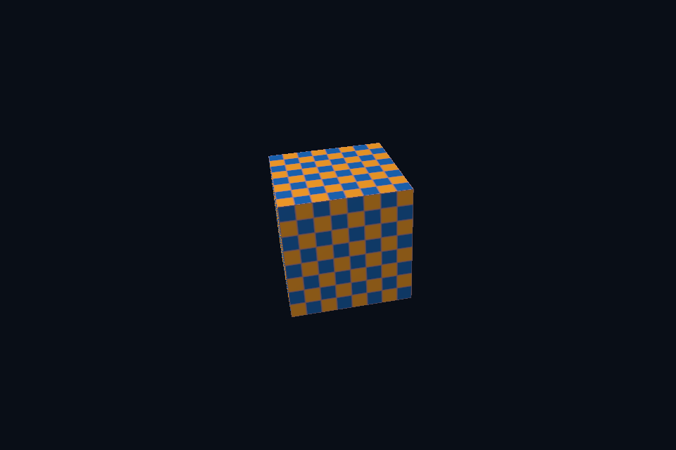

# 第 52 课 · 相机、法线与直接光 PBR 对齐 · Vulkan 原生

[54 课目录](../../COURSE.md) · [对照精讲](../../../../docs/compare/12_lighting_pbr_ibl.md) · [上一课](../51_indirect/README.md) · [下一课](../53_measure_cache/README.md)

## 本课目标与先修

学习目标：解释“相机、法线与直接光 PBR 对齐”解决的问题，找到实际对象和参数，运行对应实验并用数据/画面证明。先完成前一课，并能说明它交付的对象与完成条件；本课在该依赖上增加新契约。

## 为什么需要这一层

本章是基础教程之后的材质/场景扩展。轨道相机按时间绕模型，投影根据当前 aspect 更新；PBR 对照则固定几何、灯光、metal/roughness 和显示编码。先统一输入，再比较 API 差异。

## Vulkan 原生 的对象、参数与执行推导

共享右手世界与 0..1 深度，正高度 viewport 下投影 Y 翻转。SceneVk 支持按实际尺寸提供相机矩阵。PBR shader 采用 GGX/Schlick 直接光模型；当前显式后端没有完整 IBL 预计算或动画材质系统。

## 对照 DirectX 12：相同问题的另一种分工

相同 GLM 列主序与 HLSL mul(M,v) 连接；当前场景的简化法线变换只用于旋转/均匀缩放。导入静态层级时已在 CPU 用逆转置处理节点法线；新增非均匀模型变换仍需正确 shader 约定。

## 关键参数与可检查不变量

| 检查项 | Vulkan 表达 | DX12 表达 | 不变量 / 证据 |
| --- | --- | --- | --- |
| 相机 | 按实际 aspect 提供 Frame | 相同右手数学 | Vulkan 投影 Y 转换明确 |
| PBR 输入 | metal/roughness / direct lights | 相同共享参数 | 先统一输入再比较公式 |
| 未完成部分 | 完整 IBL/材质/skin 待扩展 | 相同范围 | 不靠最终图模糊实现边界 |

先为每项指出源码中的创建/绑定位置，以及证明它成立的实际日志、字节或图像。数值中的设备限制以查询为准；固定实验尺寸不当作所有设备的上限。

## nvpro_core2 框架对照

nv06 的 roughness UI 与原生 PBR 共享 shader，但视口尺寸/UI 成本不同。对照实验先固定倍率和目标大小。

这部分是原生 Vulkan 各课的框架对照，框架可运行入口仍为原有六课。如果本节需要新接入工作，会按正文说明；不把原生实验当作已完成的框架实现。

## 运行与实际检查

| 路线 | 实际实验 |
| --- | --- |
| Vulkan 原生 | [vk23_orbit_camera](../../lessons/vk23_orbit_camera/README.md) |
| Vulkan 原生 | [vk09_pbr](../../lessons/vk09_pbr/README.md) |
| DirectX 12 | [dx23_orbit_camera](../../../../DirectX12/lessons/dx23_orbit_camera/README.md) |
| DirectX 12 | [dx09_pbr](../../../../DirectX12/lessons/dx09_pbr/README.md) |

从合集根目录执行；普通图形程序 Esc 退出，设备/计算/诊断程序输出结果后结束。从“开始学习.cmd”进入本页时，表格可直接点击运行。

```powershell
cmake --preset vulkan-native
cmake --build --preset vulkan-native-debug --target vk23_orbit_camera --parallel 4
.\Vulkan\native\build\bin\Debug\vk23_orbit_camera.exe
ctest --preset vulkan-native-debug -R "^vk23_orbit_camera$" --output-on-failure
```

检查三个层次：创建/绑定/提交的接口约束；数据读回或目标画面；资源使用结束后的回收。诊断实验用合法信息或查询证明渠道可用，不故意保留 API 错误。图形 smoke 的像素检查与数值实验的逐项检查不同，具体实现见源码。

## 关键实现：从当前源码定位

来自 [Vulkan/native/common/advanced_labs.cpp](../../common/advanced_labs.cpp#L688)，第 688—731 行。下列是当前仓库的局部切片，可能在函数中间结束；完整上下文请打开文件，切片不作为单独可编译程序。

```cpp
            scene.frameProvider = [](float aspect, float time, bool vulkan) {
                auto projection = glm::perspectiveRH_ZO(glm::radians(48.f), aspect, .1f, 100.f);
                if (vulkan)
                    projection[1][1] *= -1;
                glm::vec3 eye(std::sin(time * .3f) * 4, 1.6f, std::cos(time * .3f) * 4);
                return Frame{projection * glm::lookAtRH(eye, glm::vec3(0), glm::vec3(0, 1, 0))};
            };
        // 这两课直接使用数学裁剪坐标；显式翻转 Y，使正高度 Vulkan viewport 与 DX12 映射一致。
        if (id == 29 || id == 53)
            scene.frameProvider = [](float, float, bool vulkan) {
                Frame result;
                if (vulkan)
                    result.viewProjection[1][1] = -1;
                return result;
            };
    };
    render.update = [id](SceneVk& scene, float time) {
        if (id == 29)
            std::static_pointer_cast<RenderState>(scene.extension)->particles->execute(time);
    };
    return nativeMain(argc, argv, mode, render);
}
void surfaceInspection() {
    require(glfwInit() != 0, "GLFW init failed");
    glfwWindowHint(GLFW_CLIENT_API, GLFW_NO_API);
    glfwWindowHint(GLFW_VISIBLE, GLFW_FALSE);
    auto* window = glfwCreateWindow(320, 240, "Surface inspection", nullptr, nullptr);
    require(window != nullptr, "Window failed");
    {
        NativeDevice owner(window);
        VkSurfaceCapabilitiesKHR caps{};
        vkCheck(vkGetPhysicalDeviceSurfaceCapabilitiesKHR(owner.c.physical, owner.surface, &caps));
        uint32_t formats{}, modes{};
        vkCheck(vkGetPhysicalDeviceSurfaceFormatsKHR(
            owner.c.physical, owner.surface, &formats, nullptr));
        vkCheck(vkGetPhysicalDeviceSurfacePresentModesKHR(
            owner.c.physical, owner.surface, &modes, nullptr));
        require(formats > 0 && modes > 0, "Surface has no formats/present modes");
        std::cout << "Surface minImages=" << caps.minImageCount
                  << ", maxImages=" << caps.maxImageCount << ", formats=" << formats
                  << ", presentModes=" << modes << '\n';
    }
    glfwDestroyWindow(window);
    glfwTerminate();
```

阅读时按“前置对象 → 参数/布局 → 录制/调用 → 完成/可见性 → 释放”五步标注。共享 helper 减少重复代码，但不会取消每课的 API 契约。

## 受控修改实验

先输出 N，再输出 NoL，最后加入 D/G/F，说明这样如何定位亮度不一致。

先记录预测，再只改一个因素；保留基线与修改后的输出。不要同时改变 shader、资源范围和同步，这样即使结果变好也无法归因。

### 参考推导与通过标准

法线不同先查空间与布局；法线一致而高光形状不同查 roughness/BRDF；整体比例不同查灯光、衰减、tone mapping/gamma。不要靠任意曝光隐藏输入错误。

## 常见失败与排查顺序

把现有截图当逐像素回归或把轨道相机称为完整自由相机，都会夸大当前实现。实验输入和交互范围要写清楚。

先看第一条错误和当前执行路径，再看实际数据/绑定，最后看 shader 与画面。需要 GPU 证据时抓取正常交互帧；仅四帧的 smoke 适合自动检查，不适合手动抓帧。

## 自测与本课交付

能否不看源码回答：先输出 N，再输出 NoL，最后加入 D/G/F，说明这样如何定位亮度不一致。

提交一份简短记录：输入与假设、唯一修改、预期、实际证据、原因、是否恢复基线。如果只能复述函数名而说不清何时允许访问/释放，先回到本课的数据流。

## 官方阅读位置与当前工程差异

[指定 Vulkan 教程对应位置](https://docs.vulkan.net.cn/tutorial/latest/11_Compute_Shader.html)。DX12 路线按同一概念顺序建立映射，其对象与约束以 Microsoft 文档和本后端代码为准。49—54 课包含在基础/compute 之后加入的工程扩展。

[版本与资料说明](../../../../docs/REFERENCES.md) · [调试](../../../../docs/DEBUGGING.md) · [功能完成度](../../../../docs/FEATURE_MATRIX.md)

## 固定输入的实际 GPU 读回


