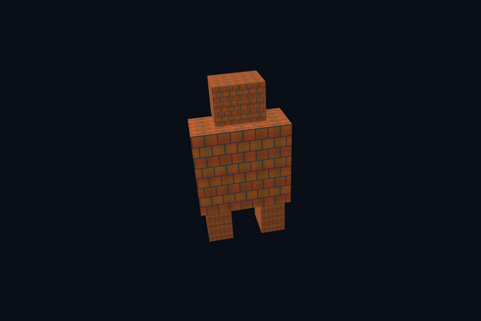

# 第 54 课 · 综合场景、验收与工程化边界 · Vulkan 原生

[54 课目录](../../COURSE.md) · [对照精讲](../../../../docs/compare/15_framework_architecture.md) · [上一课](../53_measure_cache/README.md)

## 本课目标与先修

学习目标：解释“综合场景、验收与工程化边界”解决的问题，找到实际对象和参数，运行对应实验并用数据/画面证明。先完成前一课，并能说明它交付的对象与完成条件；本课在该依赖上增加新契约。

## 为什么需要这一层

毕业任务分为可见综合场景和自动资源验收。前者组合静态 glTF 节点、图片、颜色链路、mip、轨道相机和 4x MSAA；后者检查能力、设备拷贝、所有 mip texel 和两槽提交数据。两种证据覆盖不同层次。

## Vulkan 原生 的对象、参数与执行推导

综合例通过 SceneVk 的显式配置连接资产、纹理与目标，保持可追踪资源拥有者。resize 重建时配置回调重建所需引用。当前窗口仍按帧等待，计算资源环证明两槽原则而非替代完整多帧呈现引擎。

## 对照 DirectX 12：相同问题的另一种分工

同样的 CPU 几何进入独立后端，texture view、MSAA resolve 和 CBV/PSO 使用期由 DX12 规则维护。CPU 生成正确 sRGB mip 与线性 GPU compute mip 是两条明确路径，不能混称同一种算法。

## 关键参数与可检查不变量

| 检查项 | Vulkan 表达 | DX12 表达 | 不变量 / 证据 |
| --- | --- | --- | --- |
| 可见综合 | 静态节点+图片+mip+MSAA | 同类固定输入场景 | 检查图像并说明场景范围 |
| 自动验收 | 能力/拷贝/mip/两槽 | 同类数据闭环 | 数值与图像证据分别保留 |
| 工程下一步 | 完整材质/skin/IBL/多帧呈现 | 相同阶段边界 | 先定义资源表与 pass 依赖再扩代码 |

先为每项指出源码中的创建/绑定位置，以及证明它成立的实际日志、字节或图像。数值中的设备限制以查询为准；固定实验尺寸不当作所有设备的上限。

## nvpro_core2 框架对照

作为逐课框架对照，给出 Context/Allocator/Application/RenderTarget 接入责任；六个 nvpro 例仍独立可用。本轮没有将原生 54 个实验重新包装成另一套已完成框架程序。

这部分是原生 Vulkan 各课的框架对照，框架可运行入口仍为原有六课。如果本节需要新接入工作，会按正文说明；不把原生实验当作已完成的框架实现。

## 本章独立工程与关键注释

[main.cpp](main.cpp) · [本地辅助实现](support/) · [本章着色器](shaders/) · [CMakeLists.txt](CMakeLists.txt)

完整源码就在本目录，关键步骤含中文注释。只复用 GLFW/GLM/Assimp 等第三方库，不包含或链接其他章节的课程实现。单独复制本章文件夹也可配置构建；初始化或纯计算章节不需要图形阶段。

```powershell
cmake -S . -B build -A x64
cmake --build build --config Debug --parallel 4
ctest --test-dir build -C Debug --output-on-failure
```

## 运行与实际检查

| 路线 | 实际实验 |
| --- | --- |
| Vulkan 原生 | [vk36_integration](../../lessons/vk36_integration/README.md) |
| Vulkan 原生 | [vk54_acceptance_suite](../../lessons/vk54_acceptance_suite/README.md) |
| DirectX 12 | [dx36_integration](../../../../DirectX12/lessons/dx36_integration/README.md) |
| DirectX 12 | [dx54_acceptance_suite](../../../../DirectX12/lessons/dx54_acceptance_suite/README.md) |

从合集根目录执行；普通图形程序 Esc 退出，设备/计算/诊断程序输出结果后结束。从“开始学习.cmd”进入本页时，表格可直接点击运行。

```powershell
cmake --preset vulkan-native
cmake --build --preset vulkan-native-debug --target vk54_ch_capstone --parallel 4
.\Vulkan\native\build\bin\Debug\vk54_ch_capstone.exe
ctest --preset vulkan-native-debug -R "^vk54_ch_capstone$" --output-on-failure
```

检查三个层次：创建/绑定/提交的接口约束；数据读回或目标画面；资源使用结束后的回收。诊断实验用合法信息或查询证明渠道可用，不故意保留 API 错误。图形 smoke 的像素检查与数值实验的逐项检查不同，具体实现见源码。

## 关键实现：从当前源码定位

来自 [Vulkan/native/chapters/54_capstone/main.cpp](main.cpp#L294)，第 294—308 行。下列是当前仓库的局部切片，可能在函数中间结束；完整上下文请打开文件，切片不作为单独可编译程序。

```cpp
int runChapter(int argc, char** argv) {
    auto options = labOptions(argc, argv, 36);
    nativeShaders = options.directory / "shaders";
    {
        return graphicsLab(argc, argv, options);
    }
}
} // namespace course

int main(int argc, char** argv) try {
    return course::runChapter(argc, argv);
} catch (const std::exception& error) {
    std::cerr << "ERROR: " << error.what() << '\n';
    return 1;
}
```

阅读时按“前置对象 → 参数/布局 → 录制/调用 → 完成/可见性 → 释放”五步标注。辅助实现与着色器是本章自己的文件；修改不会影响其他章。

## 受控修改实验

选择阴影、IBL 或骨骼动画之一，先写资源表、pass 依赖图、中间调试视图和验收条件，再实现。

先记录预测，再只改一个因素；保留基线与修改后的输出。不要同时改变 shader、资源范围和同步，这样即使结果变好也无法归因。

### 参考推导与通过标准

原生/DX12 当前完成静态模型、mip/MSAA、直接光 PBR 和计算扩展；完整 glTF 材质、skin/动画、IBL、SSAO 等仍需单独工程实现与验证。清楚标记边界比扩大功能名列表更有价值。

## 常见失败与排查顺序

最终图正确不证明所有中间资源、同步和重建组合都正确。保留自动数值检查、图像读回、人工抓帧与功能矩阵四份证据。

先看第一条错误和当前执行路径，再看实际数据/绑定，最后看 shader 与画面。需要 GPU 证据时抓取正常交互帧；仅四帧的 smoke 适合自动检查，不适合手动抓帧。

## 自测与本课交付

能否不看源码回答：选择阴影、IBL 或骨骼动画之一，先写资源表、pass 依赖图、中间调试视图和验收条件，再实现。

提交一份简短记录：输入与假设、唯一修改、预期、实际证据、原因、是否恢复基线。如果只能复述函数名而说不清何时允许访问/释放，先回到本课的数据流。

## 官方阅读位置与当前工程差异

[指定 Vulkan 教程对应位置](https://docs.vulkan.net.cn/tutorial/latest/11_Compute_Shader.html)。DX12 路线按同一概念顺序建立映射，其对象与约束以 Microsoft 文档和本后端代码为准。49—54 课包含在基础/compute 之后加入的工程扩展。

[版本与资料说明](../../../../docs/REFERENCES.md) · [调试](../../../../docs/DEBUGGING.md) · [功能完成度](../../../../docs/FEATURE_MATRIX.md)

## 固定输入的实际 GPU 读回


