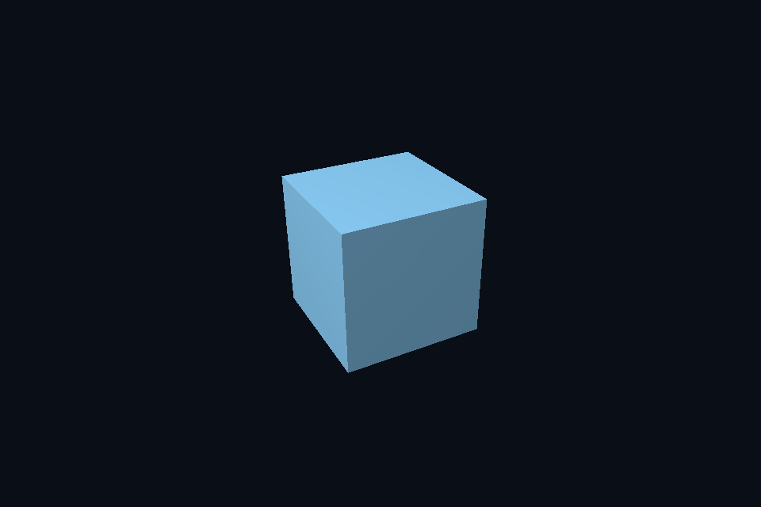

# vk05_indexed_uniform · 索引、UBO 与 Push Constants

[路线首页](../../README.md) · [上一课](../vk04_vertex_buffer/README.md) · [下一课](../vk06_texture_descriptor/README.md)

## 构建和运行

从仓库根目录执行，完成配置后后续只需 build：

```powershell
cmake --preset vulkan-native
cmake --build --preset vulkan-native-debug --target vk05_indexed_uniform --parallel 4
.\Vulkan\native\build\bin\Debug\vk05_indexed_uniform.exe
```

也可以通过根目录“开始学习.cmd”打开页面后点击“运行本课”。01/08 是控制台计算/设备检查示例，点击后可用“查看运行输出”阅读结果。其余示例 Esc 退出，拖动窗口可测试尺寸重建。

预期结果：旋转立方体，前后遮挡正确。

## 先读哪些代码

Frame/Draw → SceneVk uniform/descriptor/pipelineLayout → render → vkCmdDrawIndexed。

本目录 [main.cpp](main.cpp) 选择本课的执行路径。完整 API 实现在 `common/native_app.hpp 与 ../common/scene_vk.hpp`（相对路线根目录），数学和网格在仓库 shared/scene.hpp。每课都是独立程序；共享代码避免把相同资源生命周期错误复制十遍，也会为后续课预先初始化部分公共状态。首次阅读只沿本课列出的调用路径展开。

## 原理和实现

每帧 viewProjection 存在 binding 0 的 uniform buffer；每次对象绘制的 model/settings 通过 80 字节 push constants 更新。UBO 与 push constants 解决不同粒度的数据，不应只因数据较少就把整场景塞进 root/push 接口。索引用 uint32，因此绑定类型是 VK_INDEX_TYPE_UINT32。立方体每面独立顶点保留硬边法线与 UV；深度附件为 D32，清为 1，以 LESS 保留更近片段。

## 修改练习

添加第二个立方体，复用 UBO、单独更新 model；输出 sizeof(Frame/Draw) 核对布局。

修改 shader 后重新构建，再运行。Vulkan GLSL 会被编译并复制到 exe 旁的 shaders；DX12 的 HLSL 副本也随构建更新，运行时再编译。应修改源目录而不是运行副本。

## 自测

为什么 push constant 的 stageFlags 要覆盖使用它的两个 shader 阶段？

参考：pipeline layout 声明允许访问的阶段，实际更新范围和 shader 使用都必须兼容。


## 验证和调试

运行 `vk05_indexed_uniform.exe --smoke` 执行四帧（或设备/计算检查）并退出；颜色课会从 GPU 读回 PPM，计算课验证 256 个数。参见仓库 [调试指南](../../../../docs/DEBUGGING.md)。这些基础例子按帧串行等待，重点是可追踪的生命周期；多帧重叠不能仅删除 wait，需要同时改成帧资源环。


## 实测画面

固定时间的 GPU 读回图像（nvpro 为 headless Viewport 输出）。




## 深入学习：数据、接口与执行

索引 buffer 提供复用，Frame UBO 按帧，Draw push constants 按对象。80 字节范围与 vertex/fragment 阶段声明一致；同一资源被 GPU 读取期间，CPU 更新仍受同步约束。

配套精讲：[三 API 对照 · 常量与资源绑定](../../../../docs/compare/05_binding_constants.md)。先读概念与参数选择，再返回本课实现核对，不必一次展开所有公共类。

### 本课的真实源码切片

来自 [Vulkan/common/scene_vk.hpp](../../../common/scene_vk.hpp#L282)，第 282—311 行；这是现有实现的局部摘录，末尾可能处于函数中间，不是可单独编译的完整程序。

```cpp
        VkDescriptorSetLayoutBinding bindings[2] = {
            {0, VK_DESCRIPTOR_TYPE_UNIFORM_BUFFER, 1, VK_SHADER_STAGE_VERTEX_BIT, nullptr},
            {1,
             VK_DESCRIPTOR_TYPE_COMBINED_IMAGE_SAMPLER,
             1,
             VK_SHADER_STAGE_FRAGMENT_BIT,
             nullptr}};
        VkDescriptorSetLayoutCreateInfo li{VK_STRUCTURE_TYPE_DESCRIPTOR_SET_LAYOUT_CREATE_INFO};
        li.bindingCount = 2;
        li.pBindings = bindings;
        vkCheck(vkCreateDescriptorSetLayout(c.device, &li, nullptr, &setLayout));
        VkDescriptorPoolSize sizes[2] = {{VK_DESCRIPTOR_TYPE_UNIFORM_BUFFER, 1},
                                         {VK_DESCRIPTOR_TYPE_COMBINED_IMAGE_SAMPLER, 1}};
        VkDescriptorPoolCreateInfo pool{VK_STRUCTURE_TYPE_DESCRIPTOR_POOL_CREATE_INFO};
        pool.maxSets = 1;
        pool.poolSizeCount = 2;
        pool.pPoolSizes = sizes;
        vkCheck(vkCreateDescriptorPool(c.device, &pool, nullptr, &descriptorPool));
        VkDescriptorSetAllocateInfo da{VK_STRUCTURE_TYPE_DESCRIPTOR_SET_ALLOCATE_INFO};
        da.descriptorPool = descriptorPool;
        da.descriptorSetCount = 1;
        da.pSetLayouts = &setLayout;
        vkCheck(vkAllocateDescriptorSets(c.device, &da, &descriptor));
        VkDescriptorBufferInfo ub{uniform.buffer, 0, sizeof(Frame)};
        VkDescriptorImageInfo image{
            sampler, texture.view, VK_IMAGE_LAYOUT_SHADER_READ_ONLY_OPTIMAL};
        VkWriteDescriptorSet writes[2]{};
        for (auto& w : writes) {
            w.sType = VK_STRUCTURE_TYPE_WRITE_DESCRIPTOR_SET;
            w.dstSet = descriptor;
```

### 同主题跨 API 导航

以下是同主题参考；场景、功能完成度和版本基线可能不同，具体边界见对照章节。

| 路线 | 可运行参照 / 当前范围 |
| --- | --- |
| OpenGL | [28_ubo](../../../../OpenGL/lessons/28_ubo/README.md) |
| Vulkan 原生 | [vk05_indexed_uniform](README.md) |
| Vulkan / nvpro_core2 | [nv06_pbr_viewport](../../../nvpro/lessons/nv06_pbr_viewport/README.md) |
| DirectX 12 | [dx05_indexed_cbv](../../../../DirectX12/lessons/dx05_indexed_cbv/README.md) |

### 先预测，再验证

给第二个对象换 model 是否需要新建 pipeline？

参考推导：不需要；每次 draw 更新 push constants。只有真正改变不可动态状态或 shader 兼容性时才考虑管线变化。

在一次实验中只改一个因素，记录预测、实际画面/日志和原因。检查已有 smoke 是否仍通过；图形调试器里再核对本次 draw 的实际输入/输出，不能仅凭进程正常退出下结论。
