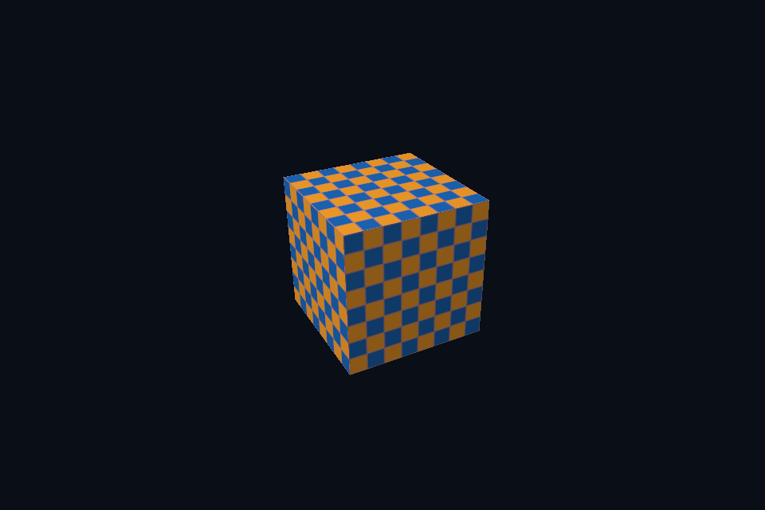

# vk06_texture_descriptor · 纹理、Staging 与 Descriptor

[路线首页](../../README.md) · [上一课](../vk05_indexed_uniform/README.md) · [下一课](../vk07_depth_instancing/README.md)

## 构建和运行

从仓库根目录执行，完成配置后后续只需 build：

```powershell
cmake --preset vulkan-native
cmake --build --preset vulkan-native-debug --target vk06_texture_descriptor --parallel 4
.\Vulkan\native\build\bin\Debug\vk06_texture_descriptor.exe
```

也可以通过根目录“开始学习.cmd”打开页面后点击“运行本课”。01/08 是控制台计算/设备检查示例，点击后可用“查看运行输出”阅读结果。其余示例 Esc 退出，拖动窗口可测试尺寸重建。

预期结果：棋盘纹理立方体。

## 先读哪些代码

SceneVk checker → staging buffer → VkImageResource → CopyBufferToImage → descriptors binding 1。

本目录 [main.cpp](main.cpp) 选择本课的执行路径。完整 API 实现在 `common/native_app.hpp 与 ../common/scene_vk.hpp`（相对路线根目录），数学和网格在仓库 shared/scene.hpp。每课都是独立程序；共享代码避免把相同资源生命周期错误复制十遍，也会为后续课预先初始化部分公共状态。首次阅读只沿本课列出的调用路径展开。

## 原理和实现

纹理使用 optimal tiling 的 device-local image，CPU 先写 staging buffer，再通过传输命令复制。UNDEFINED→TRANSFER_DST→SHADER_READ_ONLY 的转换同时声明合适的阶段和访问范围；只有转换布局而没有写后读依赖并不完整。binding 1 是 combined image sampler，descriptor 保存采样器、view 与预期布局。棋盘以 sRGB 格式上传，颜色读取时自动变成线性数据。

## 修改练习

改为 nearest 采样；改变图案大小；把纹理替换为自己的解码像素，并检查行/通道。

修改 shader 后重新构建，再运行。Vulkan GLSL 会被编译并复制到 exe 旁的 shaders；DX12 的 HLSL 副本也随构建更新，运行时再编译。应修改源目录而不是运行副本。

## 自测

Descriptor 更新后是否意味着 GPU 已经完成纹理上传？

参考：不是。描述符只描述如何访问，资源内容和执行/可见性仍需要提交与同步。

跨 API 的问题要结合本课 API 的实际对象名称回答；上面题目围绕通用概念，具体 Vulkan 名称可对照 DX12 的 CBV/SRV/UAV、root signature 和 resource barriers。

## 验证和调试

运行 `vk06_texture_descriptor.exe --smoke` 执行四帧（或设备/计算检查）并退出；颜色课会从 GPU 读回 PPM，计算课验证 256 个数。参见仓库 [调试指南](../../../../docs/DEBUGGING.md)。这些基础例子按帧串行等待，重点是可追踪的生命周期；多帧重叠不能仅删除 wait，需要同时改成帧资源环。


## 实测画面

固定时间的 GPU 读回图像（nvpro 为 headless Viewport 输出）。


