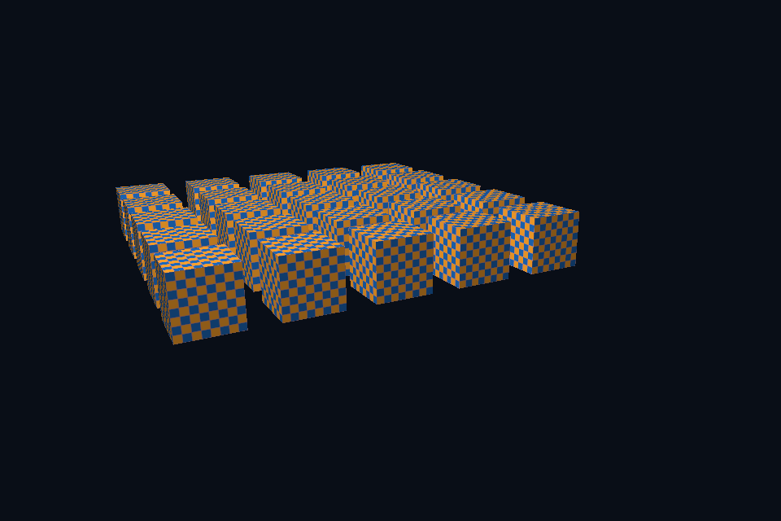

# vk07_depth_instancing · 深度与实例化

[路线首页](../../README.md) · [上一课](../vk06_texture_descriptor/README.md) · [下一课](../vk08_compute_readback/README.md)

## 构建和运行

从仓库根目录执行，完成配置后后续只需 build：

```powershell
cmake --preset vulkan-native
cmake --build --preset vulkan-native-debug --target vk07_depth_instancing --parallel 4
.\Vulkan\native\build\bin\Debug\vk07_depth_instancing.exe
```

也可以通过根目录“开始学习.cmd”打开页面后点击“运行本课”。01/08 是控制台计算/设备检查示例，点击后可用“查看运行输出”阅读结果。其余示例 Esc 退出，拖动窗口可测试尺寸重建。

预期结果：一次提交绘制 25 个棋盘立方体。

## 先读哪些代码

scene.vert gl_InstanceIndex → SceneVk::render(instanceCount=25) → depth attachment barriers。

本目录 [main.cpp](main.cpp) 选择本课的执行路径。完整 API 实现在 `common/native_app.hpp 与 ../common/scene_vk.hpp`（相对路线根目录），数学和网格在仓库 shared/scene.hpp。每课都是独立程序；共享代码避免把相同资源生命周期错误复制十遍，也会为后续课预先初始化部分公共状态。首次阅读只沿本课列出的调用路径展开。

## 原理和实现

实例化复用几何，在 shader 里用 gl_InstanceIndex 产生位置偏移。它减少 CPU draw 提交次数，却不减少总顶点和片段处理量。深度测试属于 pipeline 状态，深度图像还需正确 layout、清除、格式与访问范围。此例使用单个共享 UBO/深度图并串行等待队列，便于证明安全；生产多帧重叠必须给每帧数据和附件安排独立生命周期。

## 修改练习

把实例数改为 100 并调整排列；关闭深度测试观察覆盖错误；加入视锥剔除思考。

修改 shader 后重新构建，再运行。Vulkan GLSL 会被编译并复制到 exe 旁的 shaders；DX12 的 HLSL 副本也随构建更新，运行时再编译。应修改源目录而不是运行副本。

## 自测

有 100 个实例是否就只处理一份顶点？

参考：不会，每个实例仍执行顶点着色与光栅化，只是复用几何与提交。


## 验证和调试

运行 `vk07_depth_instancing.exe --smoke` 执行四帧（或设备/计算检查）并退出；颜色课会从 GPU 读回 PPM，计算课验证 256 个数。参见仓库 [调试指南](../../../../docs/DEBUGGING.md)。这些基础例子按帧串行等待，重点是可追踪的生命周期；多帧重叠不能仅删除 wait，需要同时改成帧资源环。


## 实测画面

固定时间的 GPU 读回图像（nvpro 为 headless Viewport 输出）。




## 深入学习：数据、接口与执行

一次 indexed draw 发出 25 个实例，gl_InstanceIndex 产生网格偏移。共享深度图每帧清除，LESS 配合 0..1 投影保留近片段；几何和实例数量应分别记录。

配套精讲：[三 API 对照 · 目标、深度与 MSAA](../../../../docs/compare/07_targets_depth_msaa.md)。先读概念与参数选择，再返回本课实现核对，不必一次展开所有公共类。

### 本课的真实源码切片

来自 [Vulkan/native/common/native_app.hpp](../../common/native_app.hpp#L412)，第 412—441 行；这是现有实现的局部摘录，末尾可能处于函数中间，不是可单独编译的完整程序。

```cpp
            VkRenderingAttachmentInfo color{VK_STRUCTURE_TYPE_RENDERING_ATTACHMENT_INFO};
            color.imageView =
                options.samples == VK_SAMPLE_COUNT_1_BIT ? targetView : swap.multisample.view;
            if (options.samples != VK_SAMPLE_COUNT_1_BIT) {
                color.resolveMode = VK_RESOLVE_MODE_AVERAGE_BIT;
                color.resolveImageView = targetView;
                color.resolveImageLayout = VK_IMAGE_LAYOUT_COLOR_ATTACHMENT_OPTIMAL;
            }
            color.imageLayout = VK_IMAGE_LAYOUT_COLOR_ATTACHMENT_OPTIMAL;
            color.loadOp = VK_ATTACHMENT_LOAD_OP_CLEAR;
            color.storeOp = VK_ATTACHMENT_STORE_OP_STORE;
            color.clearValue.color = {{.035f, .055f, .09f, 1}};
            VkRenderingAttachmentInfo depth{VK_STRUCTURE_TYPE_RENDERING_ATTACHMENT_INFO};
            depth.imageView = swap.depth.view;
            depth.imageLayout = VK_IMAGE_LAYOUT_DEPTH_ATTACHMENT_OPTIMAL;
            depth.loadOp = VK_ATTACHMENT_LOAD_OP_CLEAR;
            depth.storeOp = VK_ATTACHMENT_STORE_OP_DONT_CARE;
            depth.clearValue.depthStencil = {1, 0};
            VkRenderingInfo render{VK_STRUCTURE_TYPE_RENDERING_INFO};
            render.renderArea = {{0, 0}, swap.extent};
            render.layerCount = 1;
            render.colorAttachmentCount = 1;
            render.pColorAttachments = &color;
            render.pDepthAttachment = &depth;
            vkCmdBeginRendering(cmd, &render);
            if (swap.scene) {
                float time = smoke ? 1.f : float(glfwGetTime());
                if (options.update)
                    options.update(*swap.scene, time);
                swap.scene->render(cmd, swap.extent, time);
```

### 同主题跨 API 导航

以下是同主题参考；场景、功能完成度和版本基线可能不同，具体边界见对照章节。

| 路线 | 可运行参照 / 当前范围 |
| --- | --- |
| OpenGL | [29_msaa](../../../../OpenGL/lessons/29_msaa/README.md) |
| Vulkan 原生 | [vk07_depth_instancing](README.md) |
| Vulkan / nvpro_core2 | [nv02_application](../../../nvpro/lessons/nv02_application/README.md) |
| DirectX 12 | [dx10_offscreen](../../../../DirectX12/lessons/dx10_offscreen/README.md) |

### 先预测，再验证

只增加 instance count 会让顶点缓冲扩大吗？

参考推导：不会复制 CPU 顶点数据。更多调用由相同几何与实例索引生成，但 GPU 顶点/像素工作量仍增加。

在一次实验中只改一个因素，记录预测、实际画面/日志和原因。检查已有 smoke 是否仍通过；图形调试器里再核对本次 draw 的实际输入/输出，不能仅凭进程正常退出下结论。
