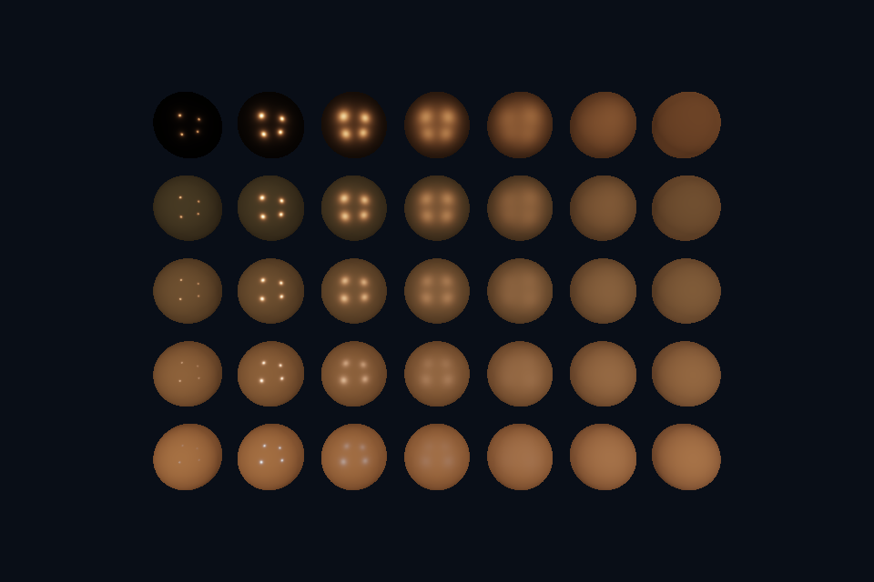

# vk09_pbr · 直接光 PBR

[路线首页](../../README.md) · [上一课](../vk08_compute_readback/README.md) · [下一课](../vk10_offscreen/README.md)

## 构建和运行

从仓库根目录执行，完成配置后后续只需 build：

```powershell
cmake --preset vulkan-native
cmake --build --preset vulkan-native-debug --target vk09_pbr --parallel 4
.\Vulkan\native\build\bin\Debug\vk09_pbr.exe
```

也可以通过根目录“开始学习.cmd”打开页面后点击“运行本课”。01/08 是控制台计算/设备检查示例，点击后可用“查看运行输出”阅读结果。其余示例 Esc 退出，拖动窗口可测试尺寸重建。

预期结果：5×7 球阵：横向粗糙度，纵向金属度。

## 先读哪些代码

shared sphere/draws → scene.frag pbr → push constants 每球参数。

本目录 [main.cpp](main.cpp) 选择本课的执行路径。完整 API 实现在 `common/native_app.hpp 与 ../common/scene_vk.hpp`（相对路线根目录），数学和网格在仓库 shared/scene.hpp。每课都是独立程序；共享代码避免把相同资源生命周期错误复制十遍，也会为后续课预先初始化部分公共状态。首次阅读只沿本课列出的调用路径展开。

## 原理和实现

复用 OpenGL 的微表面思路，采用 GGX D、Schlick 几何近似和 Fresnel，漫反射乘 (1-F)*(1-metallic)。四盏点光按距离平方衰减。roughness 保留最小值，避免除零与过尖分布。这里是直接光 PBR，加了少量环境常量；它没有移植 OpenGL 第 25 课的完整 IBL、模型加载或所有材质扩展。最后在 UNORM 目标输出前做 tone mapping 和简化 Gamma。

## 修改练习

改变基础颜色与灯光；将 metallic 固定 0/1 对比；尝试把 OpenGL IBL 预计算移植到 Vulkan。

修改 shader 后重新构建，再运行。Vulkan GLSL 会被编译并复制到 exe 旁的 shaders；DX12 的 HLSL 副本也随构建更新，运行时再编译。应修改源目录而不是运行副本。

## 自测

为什么高金属度球在没有环境光照的侧面很黑？

参考：金属没有该模型中的漫反射，未被直接光覆盖的反射方向需要真实环境照明来提供能量。

跨 API 的问题要结合本课 API 的实际对象名称回答；上面题目围绕通用概念，具体 Vulkan 名称可对照 DX12 的 CBV/SRV/UAV、root signature 和 resource barriers。

## 验证和调试

运行 `vk09_pbr.exe --smoke` 执行四帧（或设备/计算检查）并退出；颜色课会从 GPU 读回 PPM，计算课验证 256 个数。参见仓库 [调试指南](../../../../docs/DEBUGGING.md)。这些基础例子按帧串行等待，重点是可追踪的生命周期；多帧重叠不能仅删除 wait，需要同时改成帧资源环。


## 实测画面

固定时间的 GPU 读回图像（nvpro 为 headless Viewport 输出）。


