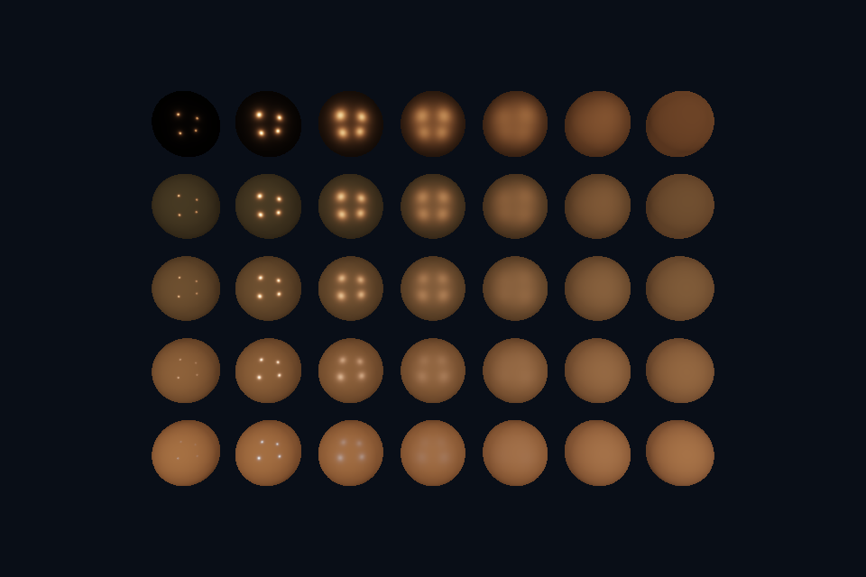

# vk10_offscreen · 离屏目标与图像传输

## 本课独立工程与关键注释

[main.cpp](main.cpp) · [本地辅助实现](support/) · [本课着色器](shaders/) · [CMakeLists.txt](CMakeLists.txt)

本目录拥有完整课程源码、资源与依赖配方。关键步骤含中文注释，不链接其他课的课程实现。可将整个目录复制到其他位置，用以下命令单独构建和检查；第三方依赖首次配置需要联网或提供缓存。

```powershell
cmake -S . -B build -A x64
cmake --build build --config Debug --parallel 4
ctest --test-dir build -C Debug --output-on-failure
```

[路线首页](../../README.md) · [上一课](../vk09_pbr/README.md) · [下一课](../../README.md)

## 构建和运行

从仓库根目录执行，完成配置后后续只需 build：

```powershell
cmake --preset vulkan-native
cmake --build --preset vulkan-native-debug --target vk10_offscreen --parallel 4
.\Vulkan\native\build\bin\Debug\vk10_offscreen.exe
```

也可以通过根目录“开始学习.cmd”打开页面后点击“运行本课”。01/08 是控制台计算/设备检查示例，点击后可用“查看运行输出”阅读结果。其余示例 Esc 退出，拖动窗口可测试尺寸重建。

预期结果：PBR 先画进独立 RGBA8 目标，再 blit 到交换链显示。

## 先读哪些代码

Swapchain offscreen → SceneVk(format=RGBA8) → COLOR_ATTACHMENT→TRANSFER_SRC → vkCmdBlitImage。

本目录 [main.cpp](main.cpp) 选择本课的执行路径。完整 API 实现在 `common/native_app.hpp 与 ../common/scene_vk.hpp`（相对路线根目录），数学和网格在仓库 shared/scene.hpp。每课都是独立程序；共享代码避免把相同资源生命周期错误复制十遍，也会为后续课预先初始化部分公共状态。首次阅读只沿本课列出的调用路径展开。

## 原理和实现

本课把可见性与中间渲染结果拆开：pipeline 输出格式与离屏图一致，再按交换链格式转换/复制。图像 blit 与同格式 copy 不同，需要检查传输 usage 和设备格式支持。当前使用单采样同尺寸颜色，便于核对状态；没有额外色调后处理 pass。CPU 测试再把最终交换链图像复制到 readback buffer，等待完成后写 PPM。

## 修改练习

把离屏目标缩为一半尺寸，再用线性 blit 放大，并检查 format features；扩展单独的全屏后处理 pipeline。

修改 shader 后重新构建，再运行。Vulkan GLSL 会被编译并复制到 exe 旁的 shaders；DX12 的 HLSL 副本也随构建更新，运行时再编译。应修改源目录而不是运行副本。

## 自测

为什么不能给一个缺少 TRANSFER_SRC usage 的图像随意执行 blit？

参考：usage 是创建资源时对合法用途的声明，后续命令必须符合声明和设备格式能力。


## 验证和调试

运行 `vk10_offscreen.exe --smoke` 执行四帧（或设备/计算检查）并退出；颜色课会从 GPU 读回 PPM，计算课验证 256 个数。参见仓库 [调试指南](../../../../docs/DEBUGGING.md)。这些基础例子按帧串行等待，重点是可追踪的生命周期；多帧重叠不能仅删除 wait，需要同时改成帧资源环。


## 实测画面

固定时间的 GPU 读回图像（nvpro 为 headless Viewport 输出）。




## 深入学习：数据、接口与执行

离屏图渲染后转 transfer-src，交换链图转 transfer-dst，再 blit 并恢复呈现用途。blit 是传输路径，不会运行自定义后处理片元 shader。

配套精讲：[三 API 对照 · 阴影、SSAO 与后处理](../../../../docs/compare/13_multipass_effects.md)。先读概念与参数选择，再返回本课实现核对，不必一次展开所有公共类。

### 本课的真实源码切片

来自 [Vulkan/native/lessons/vk10_offscreen/main.cpp](main.cpp#L9)，第 9—64 行；这是现有实现的局部摘录，末尾可能处于函数中间，不是可单独编译的完整程序。

```cpp
int runChapter(int argc, char** argv) {
    NativeRenderOptions options;

    bool smoke = false;
    for (int i = 1; i < argc; ++i)
        smoke |= std::strcmp(argv[i], "--smoke") == 0;
    validationErrors = 0;
    nativeShaders =
        std::filesystem::absolute(argv[0]).parent_path() / COURSE_RUNTIME_NAME / "shaders";
    // 设备探测和计算课不创建窗口，也不需要 surface 或交换链。
    if (!glfwInit())
        throw std::runtime_error("GLFW initialization failed");
    glfwWindowHint(GLFW_CLIENT_API, GLFW_NO_API);
    if (smoke)
        glfwWindowHint(GLFW_VISIBLE, GLFW_FALSE);
    auto window = glfwCreateWindow(960, 640, "Native Vulkan Course", nullptr, nullptr);
    if (!window)
        throw std::runtime_error("Window creation failed");
    {
        NativeDevice d(window);
        Swapchain swap(d, window, 10, options);
        VkCommandPoolCreateInfo pi{VK_STRUCTURE_TYPE_COMMAND_POOL_CREATE_INFO};
        pi.flags = VK_COMMAND_POOL_CREATE_RESET_COMMAND_BUFFER_BIT;
        pi.queueFamilyIndex = d.c.family;
        VkCommandPool pool;
        vkCheck(vkCreateCommandPool(d.c.device, &pi, nullptr, &pool));
        VkCommandBufferAllocateInfo ai{VK_STRUCTURE_TYPE_COMMAND_BUFFER_ALLOCATE_INFO};
        ai.commandPool = pool;
        ai.level = VK_COMMAND_BUFFER_LEVEL_PRIMARY;
        ai.commandBufferCount = 1;
        VkCommandBuffer cmd;
        vkCheck(vkAllocateCommandBuffers(d.c.device, &ai, &cmd));
        VkSemaphoreCreateInfo si{VK_STRUCTURE_TYPE_SEMAPHORE_CREATE_INFO};
        VkSemaphore acquired;
        vkCheck(vkCreateSemaphore(d.c.device, &si, nullptr, &acquired));
        VkFenceCreateInfo fi{VK_STRUCTURE_TYPE_FENCE_CREATE_INFO};
        fi.flags = VK_FENCE_CREATE_SIGNALED_BIT;
        VkFence fence;
        vkCheck(vkCreateFence(d.c.device, &fi, nullptr, &fence));
        int frames = 0;
        while (!glfwWindowShouldClose(window) && (!smoke || frames < 4)) {
            glfwPollEvents();
            if (glfwGetKey(window, GLFW_KEY_ESCAPE) == GLFW_PRESS)
                break;
            int w, h;
            glfwGetFramebufferSize(window, &w, &h);
            if (w < 1 || h < 1) {
                glfwWaitEvents();
                continue;
            }
            if (uint32_t(w) != swap.extent.width || uint32_t(h) != swap.extent.height)
                swap.recreate();
            // 先等待上一轮命令完成，再复用命令缓冲和共享 UBO；本课程采用单帧串行同步。
            vkCheck(vkWaitForFences(d.c.device, 1, &fence, VK_TRUE, UINT64_MAX));
            uint32_t imageIndex;
            // acquire semaphore 告知 GPU 图像可用；遇到 OUT_OF_DATE 时先重建再尝试。
```

### 同主题跨 API 导航

以下是同主题参考；场景、功能完成度和版本基线可能不同，具体边界见对照章节。

| 路线 | 可运行参照 / 当前范围 |
| --- | --- |
| OpenGL | [27_ssao](../../../../OpenGL/lessons/27_ssao/README.md) |
| Vulkan 原生 | [vk10_offscreen](README.md) |
| Vulkan / nvpro_core2 | 迁移设计：RenderTarget 与 ImGui 仅是接入点；新增多遍效果仍要自己描述写后读。 |
| DirectX 12 | 迁移设计：dx10 是 CopyResource，迁移后处理需新增可采样目标和全屏像素管线。 |

### 先预测，再验证

要加入灰度后处理，能只修改 blit 参数吗？

参考推导：不能。需要可采样离屏资源、descriptor、全屏图形管线与写后采样依赖，再把结果输出到交换链。

在一次实验中只改一个因素，记录预测、实际画面/日志和原因。检查已有 smoke 是否仍通过；图形调试器里再核对本次 draw 的实际输入/输出，不能仅凭进程正常退出下结论。
