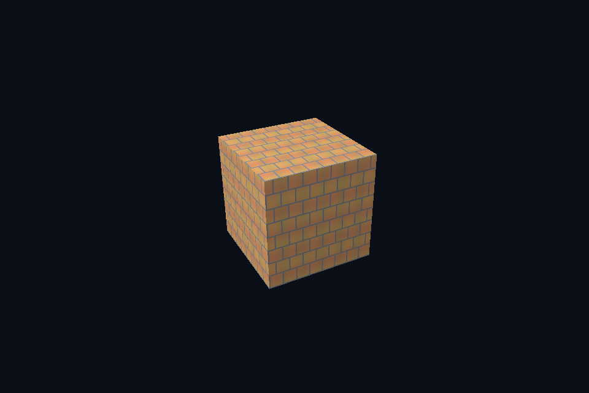

# vk17_image_file · 真实图片上传

[54 课目录](../../COURSE.md)

## 目的与实际执行

stb_image 解码后写入 staging，最终 image 使用 optimal tiling。这里只展示普通 2D 图片，压缩 GPU 格式、流式加载和完整材质导入是进一步工作，不因 PNG 成功就宣称全部资产格式已支持。

Image 创建声明 usage/format/extent/mip，MemoryRequirements 决定绑定存储。BufferImageCopy 描述缓冲到子资源的映射；先处于 TRANSFER_DST，再允许采样。创建 view 或更新 descriptor 不会替代 copy。

对比相同图片的 UNORM 与 SRGB image view/format 路径，shader 参与线性计算后手动显示编码。GPU blit 对 sRGB 格式的颜色处理也应与规范和参考值一致；数值 mip 实验使用 UNORM 以便逐 texel 对照。

本程序有独立实验选择与验证路径，公共实现集中在 advanced_labs.cpp。设备/API 检查、数值 compute 与图形渲染采用不同证据；不是每个程序都会弹出窗口。

## 构建和运行

```powershell
cmake --preset vulkan-native
cmake --build --preset vulkan-native-debug --target vk17_image_file --parallel 4
.\Vulkan\native\build\bin\Debug\vk17_image_file.exe
```

## 深入学习：数据、接口与执行

- [第 33 课：真实图片、通道与资产路径](../../chapters/33_image_decode/README.md)
- [第 34 课：图像存储、Footprint 与拷贝](../../chapters/34_image_upload/README.md)
- [第 38 课：sRGB、线性光照与显示编码](../../chapters/38_color_space/README.md)

### 本课的真实源码切片

来自 [Vulkan/native/common/advanced_labs.cpp](../../common/advanced_labs.cpp#L354)，第 354—397 行；这是现有实现的局部摘录，末尾可能处于函数中间，不是可单独编译的完整程序。

```cpp
struct GpuTexture {
    VkContextRef c;
    VkImageResource image;
    VkSampler sampler{};
    VkImageView selectedView{};
    VkFormat format{};
    std::vector<Pixels> reference;
    explicit GpuTexture(
        VkContextRef context, Pixels pixels, bool mips, bool srgb = false, bool clamp = false)
        : c(context) {
        reference = mips ? mipReference(pixels, srgb) : std::vector<Pixels>{pixels};
        uint32_t levels = uint32_t(reference.size());
        format = srgb ? VK_FORMAT_R8G8B8A8_SRGB : VK_FORMAT_R8G8B8A8_UNORM;
        if (mips) {
            VkFormatProperties properties{};
            vkGetPhysicalDeviceFormatProperties(c.physical, format, &properties);
            VkFormatFeatureFlags required = VK_FORMAT_FEATURE_BLIT_SRC_BIT |
                                            VK_FORMAT_FEATURE_BLIT_DST_BIT |
                                            VK_FORMAT_FEATURE_SAMPLED_IMAGE_FILTER_LINEAR_BIT;
            require((properties.optimalTilingFeatures & required) == required,
                    "Format cannot generate linear-blit mip chain");
        }
        image.init(c,
                   {pixels.width, pixels.height},
                   format,
                   VK_IMAGE_USAGE_SAMPLED_BIT | VK_IMAGE_USAGE_TRANSFER_SRC_BIT |
                       VK_IMAGE_USAGE_TRANSFER_DST_BIT,
                   VK_IMAGE_ASPECT_COLOR_BIT,
                   levels);
        VkBufferResource upload;
        upload.init(c, pixels.rgba.size(), VK_BUFFER_USAGE_TRANSFER_SRC_BIT);
        upload.upload(pixels.rgba.data(), pixels.rgba.size());
        immediate(c, [&](VkCommandBuffer cmd) {
            for (uint32_t i = 0; i < levels; ++i)
                imageDependency(cmd,
                                image.image,
                                i,
                                VK_IMAGE_LAYOUT_UNDEFINED,
                                VK_IMAGE_LAYOUT_TRANSFER_DST_OPTIMAL,
                                VK_PIPELINE_STAGE_2_NONE,
                                0,
                                VK_PIPELINE_STAGE_2_COPY_BIT | VK_PIPELINE_STAGE_2_BLIT_BIT,
                                VK_ACCESS_2_TRANSFER_WRITE_BIT);
            VkBufferImageCopy copy{};
```

### 同主题跨 API 导航

| 路线 | 程序 |
| --- | --- |
| Vulkan 原生 | [vk17_image_file](README.md) |
| 对照后端 | [dx17_image_file](../../../../DirectX12/lessons/dx17_image_file/README.md) |

### 先预测，再验证

把图片换成带透明通道的四象限测试图，先检查方向与字节数，再讨论混合。

参考推导：图像 RGBA 内容正确与 blending 状态正确是两件事。透明字节上传成功不代表自动启用了透明渲染。

解释一次 memcpy(width*height*4) 为什么不总能正确填 texture upload。

参考推导：API 可能要求更大的对齐行距或子资源起点。正确内容应逐行写到 footprint 的 Offset+y*RowPitch，再按有效宽度复制。

给粗糙度贴图使用 sRGB 读取，能否靠 normalize 或调曝光恢复正确粗糙度？

参考推导：不能。输入标量被非线性改写，曝光只改变输出，不能还原材质参数。先纠正数据格式与用途。

## 验证与边界

运行 `--smoke` 执行有限自动检查。数值实验读取实际 GPU 结果，图形实验检查非空图像并可查看读回。交互重建与性能还需额外证据；窗口 renderer 当前保留串行等待，双槽计算实验不会被描述为完整多帧呈现引擎。

## 实际画面


