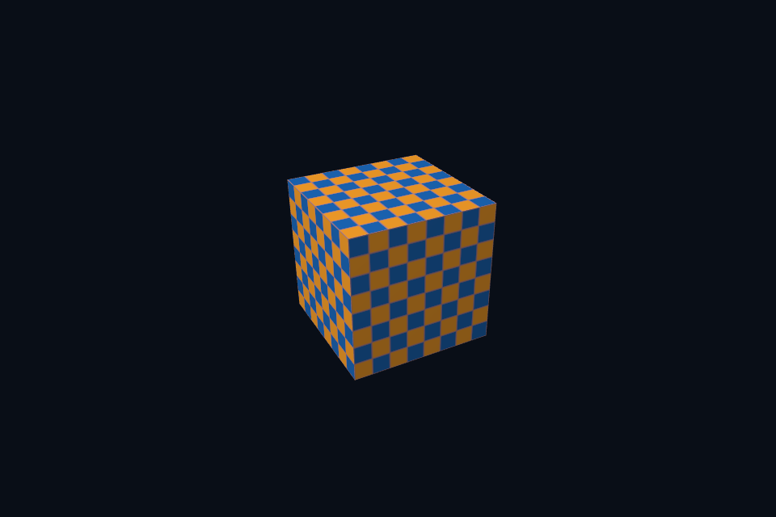

# vk20_msaa_resolve · 4x MSAA 与 Resolve

[54 课目录](../../COURSE.md)

## 本课独立工程与关键注释

[main.cpp](main.cpp) · [本地辅助实现](support/) · [本课着色器](shaders/) · [CMakeLists.txt](CMakeLists.txt)

本目录包含独立课程源码，关键位置有中文注释。单独复制整个文件夹后可用 `cmake -S . -B build -A x64` 配置、`cmake --build build --config Debug` 构建；不需要其他章节源码。

## 目的与实际执行

dynamic rendering 不创建 VkFramebuffer，但每帧仍要选择正确 image view。MSAA 例子使用多样本颜色/深度，resolve 到单样本交换链图像；管线 sample count 与附件一致。

多样本颜色和深度为 4x，graphics pipeline sample count 同样 4x；dynamic rendering 的 resolve attachment 写单样本交换链目标。输入与输出的用途和布局均要正确。

本程序的 C++、辅助实现、着色器和构建脚本均位于本目录，关键步骤含中文注释。设备/API 检查、数值 compute 与图形渲染采用不同证据；不是每个程序都会弹出窗口。

## 构建和运行

```powershell
cmake --preset vulkan-native
cmake --build --preset vulkan-native-debug --target vk20_msaa_resolve --parallel 4
.\Vulkan\native\build\bin\Debug\vk20_msaa_resolve.exe
```

## 深入学习：数据、接口与执行

- [第 17 课：帧缓冲、RTV/DSV 与尺寸相关资源](../../chapters/17_targets/README.md)
- [第 45 课：多重采样、匹配附件与 Resolve](../../chapters/45_msaa/README.md)

### 本课的真实源码切片

来自 [Vulkan/native/lessons/vk20_msaa_resolve/main.cpp](main.cpp#L40)，第 40—54 行；这是现有实现的局部摘录，末尾可能处于函数中间，不是可单独编译的完整程序。

```cpp
int runChapter(int argc, char** argv) {
    auto options = labOptions(argc, argv, 20);
    nativeShaders = options.directory / "shaders";
    {
        return graphicsLab(argc, argv, options);
    }
}
} // namespace course

int main(int argc, char** argv) try {
    return course::runChapter(argc, argv);
} catch (const std::exception& error) {
    std::cerr << "ERROR: " << error.what() << '\n';
    return 1;
}
```

### 同主题跨 API 导航

| 路线 | 程序 |
| --- | --- |
| Vulkan 原生 | [vk20_msaa_resolve](README.md) |
| 对照后端 | [dx20_msaa_resolve](../../../../DirectX12/lessons/dx20_msaa_resolve/README.md) |

### 先预测，再验证

列出 resize 影响的对象，并区分需要重建和只需更新参数的内容。

参考推导：颜色/深度/离屏存储及其 view 常需重建；viewport/scissor/aspect 更新；固定格式未变时管线不一定重建，具体取决于其不可动态状态。

在斜边放大观察单样本与 4x，同时说明为什么纹理莫尔纹仍可能存在。

参考推导：MSAA 主要改善几何覆盖边缘；纹理缩小和 shader 高频还需要 mip、过滤或其他策略。不要把所有走样归为同一个环节。

## 验证与边界

运行 `--smoke` 执行有限自动检查。数值实验读取实际 GPU 结果，图形实验检查非空图像并可查看读回。交互重建与性能还需额外证据；窗口 renderer 当前保留串行等待，双槽计算实验不会被描述为完整多帧呈现引擎。

## 实际画面


