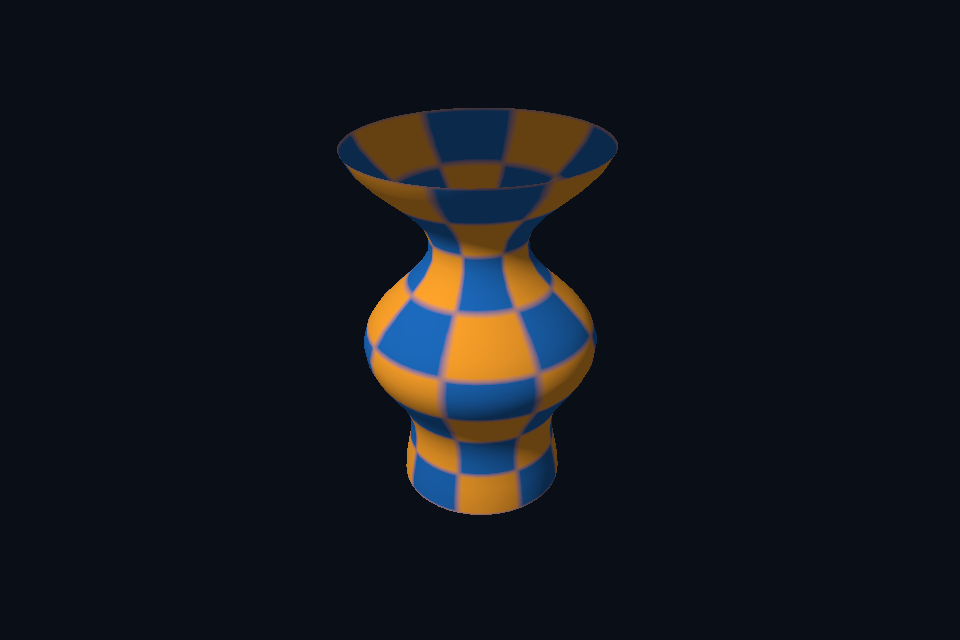

# vk21_obj_model · OBJ 静态模型

[54 课目录](../../COURSE.md)

## 本课独立工程与关键注释

[main.cpp](main.cpp) · [本地辅助实现](support/) · [本课着色器](shaders/) · [CMakeLists.txt](CMakeLists.txt)

本目录包含独立课程源码，关键位置有中文注释。单独复制整个文件夹后可用 `cmake -S . -B build -A x64` 配置、`cmake --build build --config Debug` 构建；不需要其他章节源码。

## 目的与实际执行

staticAsset 将节点变换应用到顶点，以正确法线矩阵变换 normal，再把 Geometry 交给 SceneVk。原生缓冲、布局和索引路径可复用；模型不需要一套全新的绘图 API。

本程序的 C++、辅助实现、着色器和构建脚本均位于本目录，关键步骤含中文注释。设备/API 检查、数值 compute 与图形渲染采用不同证据；不是每个程序都会弹出窗口。

## 构建和运行

```powershell
cmake --preset vulkan-native
cmake --build --preset vulkan-native-debug --target vk21_obj_model --parallel 4
.\Vulkan\native\build\bin\Debug\vk21_obj_model.exe
```

## 深入学习：数据、接口与执行

- [第 41 课：OBJ 导入、索引与几何归一化](../../chapters/41_obj_models/README.md)

### 本课的真实源码切片

来自 [Vulkan/native/lessons/vk21_obj_model/main.cpp](main.cpp#L31)，第 31—45 行；这是现有实现的局部摘录，末尾可能处于函数中间，不是可单独编译的完整程序。

```cpp
int runChapter(int argc, char** argv) {
    auto options = labOptions(argc, argv, 21);
    nativeShaders = options.directory / "shaders";
    {
        return graphicsLab(argc, argv, options);
    }
}
} // namespace course

int main(int argc, char** argv) try {
    return course::runChapter(argc, argv);
} catch (const std::exception& error) {
    std::cerr << "ERROR: " << error.what() << '\n';
    return 1;
}
```

### 同主题跨 API 导航

| 路线 | 程序 |
| --- | --- |
| Vulkan 原生 | [vk21_obj_model](README.md) |
| 对照后端 | [dx21_obj_model](../../../../DirectX12/lessons/dx21_obj_model/README.md) |

### 先预测，再验证

只加载模型位置并用固定色画出，再分阶段恢复 normal/UV，说明这种顺序的作用。

参考推导：它把解析/索引/相机问题与材质问题分开。轮廓都不正确时，先不要调灯光或寻找缺失贴图。

## 验证与边界

运行 `--smoke` 执行有限自动检查。数值实验读取实际 GPU 结果，图形实验检查非空图像并可查看读回。交互重建与性能还需额外证据；窗口 renderer 当前保留串行等待，双槽计算实验不会被描述为完整多帧呈现引擎。

## 实际画面


