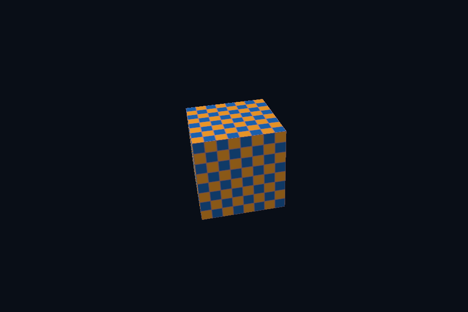

# vk23_orbit_camera · 轨道相机与投影

[54 课目录](../../COURSE.md)

## 目的与实际执行

共享右手世界与 0..1 深度，正高度 viewport 下投影 Y 翻转。SceneVk 支持按实际尺寸提供相机矩阵。PBR shader 采用 GGX/Schlick 直接光模型；当前显式后端没有完整 IBL 预计算或动画材质系统。

本程序有独立实验选择与验证路径，公共实现集中在 advanced_labs.cpp。设备/API 检查、数值 compute 与图形渲染采用不同证据；不是每个程序都会弹出窗口。

## 构建和运行

```powershell
cmake --preset vulkan-native
cmake --build --preset vulkan-native-debug --target vk23_orbit_camera --parallel 4
.\Vulkan\native\build\bin\Debug\vk23_orbit_camera.exe
```

## 深入学习：数据、接口与执行

- [第 52 课：相机、法线与直接光 PBR 对齐](../../chapters/52_camera_material/README.md)

### 本课的真实源码切片

来自 [Vulkan/native/common/advanced_labs.cpp](../../common/advanced_labs.cpp#L688)，第 688—731 行；这是现有实现的局部摘录，末尾可能处于函数中间，不是可单独编译的完整程序。

```cpp
            scene.frameProvider = [](float aspect, float time, bool vulkan) {
                auto projection = glm::perspectiveRH_ZO(glm::radians(48.f), aspect, .1f, 100.f);
                if (vulkan)
                    projection[1][1] *= -1;
                glm::vec3 eye(std::sin(time * .3f) * 4, 1.6f, std::cos(time * .3f) * 4);
                return Frame{projection * glm::lookAtRH(eye, glm::vec3(0), glm::vec3(0, 1, 0))};
            };
        // 这两课直接使用数学裁剪坐标；显式翻转 Y，使正高度 Vulkan viewport 与 DX12 映射一致。
        if (id == 29 || id == 53)
            scene.frameProvider = [](float, float, bool vulkan) {
                Frame result;
                if (vulkan)
                    result.viewProjection[1][1] = -1;
                return result;
            };
    };
    render.update = [id](SceneVk& scene, float time) {
        if (id == 29)
            std::static_pointer_cast<RenderState>(scene.extension)->particles->execute(time);
    };
    return nativeMain(argc, argv, mode, render);
}
void surfaceInspection() {
    require(glfwInit() != 0, "GLFW init failed");
    glfwWindowHint(GLFW_CLIENT_API, GLFW_NO_API);
    glfwWindowHint(GLFW_VISIBLE, GLFW_FALSE);
    auto* window = glfwCreateWindow(320, 240, "Surface inspection", nullptr, nullptr);
    require(window != nullptr, "Window failed");
    {
        NativeDevice owner(window);
        VkSurfaceCapabilitiesKHR caps{};
        vkCheck(vkGetPhysicalDeviceSurfaceCapabilitiesKHR(owner.c.physical, owner.surface, &caps));
        uint32_t formats{}, modes{};
        vkCheck(vkGetPhysicalDeviceSurfaceFormatsKHR(
            owner.c.physical, owner.surface, &formats, nullptr));
        vkCheck(vkGetPhysicalDeviceSurfacePresentModesKHR(
            owner.c.physical, owner.surface, &modes, nullptr));
        require(formats > 0 && modes > 0, "Surface has no formats/present modes");
        std::cout << "Surface minImages=" << caps.minImageCount
                  << ", maxImages=" << caps.maxImageCount << ", formats=" << formats
                  << ", presentModes=" << modes << '\n';
    }
    glfwDestroyWindow(window);
    glfwTerminate();
```

### 同主题跨 API 导航

| 路线 | 程序 |
| --- | --- |
| Vulkan 原生 | [vk23_orbit_camera](README.md) |
| 对照后端 | [dx23_orbit_camera](../../../../DirectX12/lessons/dx23_orbit_camera/README.md) |

### 先预测，再验证

先输出 N，再输出 NoL，最后加入 D/G/F，说明这样如何定位亮度不一致。

参考推导：法线不同先查空间与布局；法线一致而高光形状不同查 roughness/BRDF；整体比例不同查灯光、衰减、tone mapping/gamma。不要靠任意曝光隐藏输入错误。

## 验证与边界

运行 `--smoke` 执行有限自动检查。数值实验读取实际 GPU 结果，图形实验检查非空图像并可查看读回。交互重建与性能还需额外证据；窗口 renderer 当前保留串行等待，双槽计算实验不会被描述为完整多帧呈现引擎。

## 实际画面


