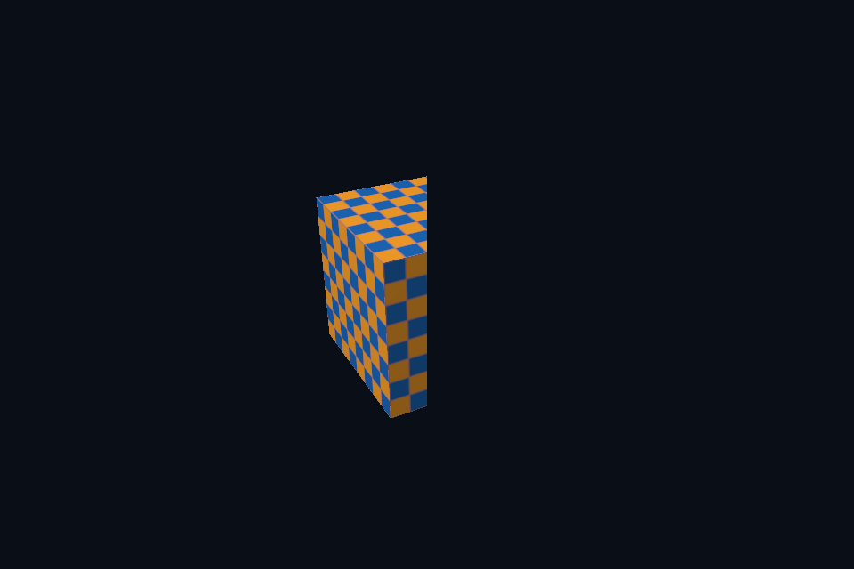

# vk34_dynamic_scissor · 动态裁剪状态

[54 课目录](../../COURSE.md)

## 目的与实际执行

分别运行 half-scissor、half-viewport、back-face culling 和 red-only 写掩码实验。viewport/scissor 是管线声明的 dynamic state，cull 与写掩码在本实现中仍是创建时配置。投影 Y 翻转也会影响屏幕绕序判断。 本实验共用外表面逆时针模型：Vulkan 使用 COUNTER_CLOCKWISE，DX12 显式设置 FrontCounterClockwise=TRUE；不可依赖两边零初始化得到同一正面。

本程序有独立实验选择与验证路径，公共实现集中在 advanced_labs.cpp。设备/API 检查、数值 compute 与图形渲染采用不同证据；不是每个程序都会弹出窗口。

## 构建和运行

```powershell
cmake --preset vulkan-native
cmake --build --preset vulkan-native-debug --target vk34_dynamic_scissor --parallel 4
.\Vulkan\native\build\bin\Debug\vk34_dynamic_scissor.exe
```

## 深入学习：数据、接口与执行

- [第 14 课：固定功能、颜色掩码、视口与剔除](../../chapters/14_fixed_function/README.md)

### 本课的真实源码切片

来自 [Vulkan/common/scene_vk.hpp](../../../common/scene_vk.hpp#L212)，第 212—255 行；这是现有实现的局部摘录，末尾可能处于函数中间，不是可单独编译的完整程序。

```cpp
    bool halfScissor = false;
    bool halfViewport = false;
    std::optional<Frame> overrideFrame;
    std::function<Frame(float, float, bool)> frameProvider;
    std::vector<Draw> overrideDraws;
    std::shared_ptr<void> extension;
    SceneVk(const VkContextRef& context,
            int lesson,
            VkFormat format,
            const std::filesystem::path& shaders,
            const Geometry* replacement = nullptr,
            VkSampleCountFlagBits samples = VK_SAMPLE_COUNT_1_BIT,
            VkPipelineCache cache = VK_NULL_HANDLE,
            VkCullModeFlags cull = VK_CULL_MODE_NONE,
            bool redOnly = false)
        : c(context), mode(lesson), colorFormat(format),
          mesh(replacement ? *replacement : geometry(lesson)) {
        if (mode >= 4) {
            vertices.init(
                c, mesh.vertices.size() * sizeof(Vertex), VK_BUFFER_USAGE_VERTEX_BUFFER_BIT);
            vertices.upload(mesh.vertices.data(), mesh.vertices.size() * sizeof(Vertex));
            if (!mesh.indices.empty()) {
                indices.init(c, mesh.indices.size() * 4, VK_BUFFER_USAGE_INDEX_BUFFER_BIT);
                indices.upload(mesh.indices.data(), mesh.indices.size() * 4);
            }
        }
        uniform.init(c, sizeof(Frame), VK_BUFFER_USAGE_UNIFORM_BUFFER_BIT);
        Frame initial;
        uniform.upload(&initial, sizeof(initial));
        auto data = checker();
        VkBufferResource upload;
        upload.init(c, data.size(), VK_BUFFER_USAGE_TRANSFER_SRC_BIT);
        upload.upload(data.data(), data.size());
        texture.init(c,
                     {64, 64},
                     VK_FORMAT_R8G8B8A8_SRGB,
                     VK_IMAGE_USAGE_SAMPLED_BIT | VK_IMAGE_USAGE_TRANSFER_DST_BIT,
                     VK_IMAGE_ASPECT_COLOR_BIT);

        // 纹理先切到传输目标布局，拷贝完成后再切到 shader 只读布局供片元阶段采样。
        immediate(c, [&](VkCommandBuffer cmd) {
            barrier(cmd,
                    texture.image,
                    VK_IMAGE_LAYOUT_UNDEFINED,
```

### 同主题跨 API 导航

| 路线 | 程序 |
| --- | --- |
| Vulkan 原生 | [vk34_dynamic_scissor](README.md) |
| 对照后端 | [dx34_dynamic_scissor](../../../../DirectX12/lessons/dx34_dynamic_scissor/README.md) |

### 先预测，再验证

先预测半视口与半裁剪的区别，再分别运行对应实验，检查模型宽高和可见区域。

参考推导：半视口把整幅几何压进较窄映射，半裁剪保留原映射但屏蔽右侧。它们可能显示相同面积，却不是相同几何变换。

## 验证与边界

运行 `--smoke` 执行有限自动检查。数值实验读取实际 GPU 结果，图形实验检查非空图像并可查看读回。交互重建与性能还需额外证据；窗口 renderer 当前保留串行等待，双槽计算实验不会被描述为完整多帧呈现引擎。

## 实际画面


