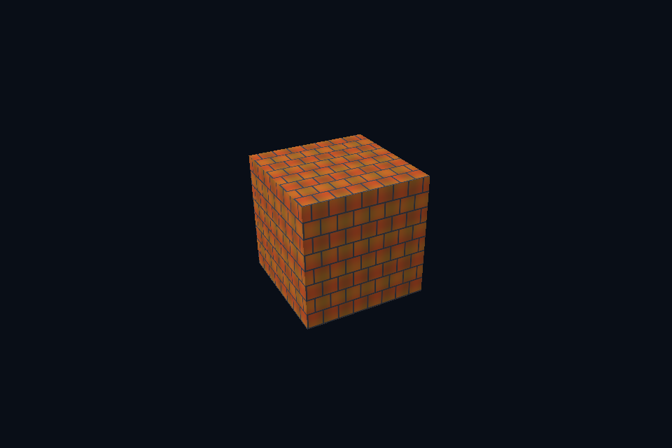

# vk35_srgb_view · sRGB 颜色视图

[54 课目录](../../COURSE.md)

## 本课独立工程与关键注释

[main.cpp](main.cpp) · [本地辅助实现](support/) · [本课着色器](shaders/) · [CMakeLists.txt](CMakeLists.txt)

本目录包含独立课程源码，关键位置有中文注释。单独复制整个文件夹后可用 `cmake -S . -B build -A x64` 配置、`cmake --build build --config Debug` 构建；不需要其他章节源码。

## 目的与实际执行

对比相同图片的 UNORM 与 SRGB image view/format 路径，shader 参与线性计算后手动显示编码。GPU blit 对 sRGB 格式的颜色处理也应与规范和参考值一致；数值 mip 实验使用 UNORM 以便逐 texel 对照。

本程序的 C++、辅助实现、着色器和构建脚本均位于本目录，关键步骤含中文注释。设备/API 检查、数值 compute 与图形渲染采用不同证据；不是每个程序都会弹出窗口。

## 构建和运行

```powershell
cmake --preset vulkan-native
cmake --build --preset vulkan-native-debug --target vk35_srgb_view --parallel 4
.\Vulkan\native\build\bin\Debug\vk35_srgb_view.exe
```

## 深入学习：数据、接口与执行

- [第 38 课：sRGB、线性光照与显示编码](../../chapters/38_color_space/README.md)

### 本课的真实源码切片

来自 [Vulkan/native/lessons/vk35_srgb_view/main.cpp](main.cpp#L272)，第 272—286 行；这是现有实现的局部摘录，末尾可能处于函数中间，不是可单独编译的完整程序。

```cpp
int runChapter(int argc, char** argv) {
    auto options = labOptions(argc, argv, 35);
    nativeShaders = options.directory / "shaders";
    {
        return graphicsLab(argc, argv, options);
    }
}
} // namespace course

int main(int argc, char** argv) try {
    return course::runChapter(argc, argv);
} catch (const std::exception& error) {
    std::cerr << "ERROR: " << error.what() << '\n';
    return 1;
}
```

### 同主题跨 API 导航

| 路线 | 程序 |
| --- | --- |
| Vulkan 原生 | [vk35_srgb_view](README.md) |
| 对照后端 | [dx35_srgb_view](../../../../DirectX12/lessons/dx35_srgb_view/README.md) |

### 先预测，再验证

给粗糙度贴图使用 sRGB 读取，能否靠 normalize 或调曝光恢复正确粗糙度？

参考推导：不能。输入标量被非线性改写，曝光只改变输出，不能还原材质参数。先纠正数据格式与用途。

## 验证与边界

运行 `--smoke` 执行有限自动检查。数值实验读取实际 GPU 结果，图形实验检查非空图像并可查看读回。交互重建与性能还需额外证据；窗口 renderer 当前保留串行等待，双槽计算实验不会被描述为完整多帧呈现引擎。

## 实际画面


