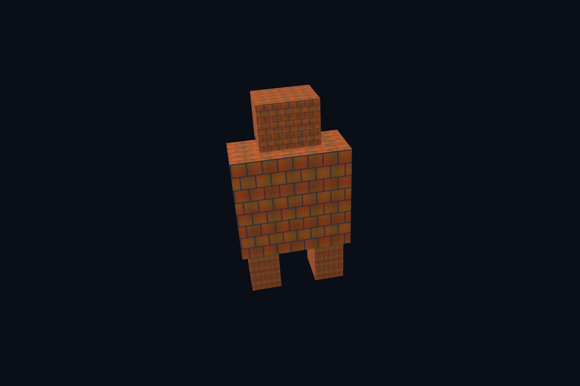

# vk36_integration · 模型纹理 mip MSAA 综合

[54 课目录](../../COURSE.md)

## 目的与实际执行

综合例通过 SceneVk 的显式配置连接资产、纹理与目标，保持可追踪资源拥有者。resize 重建时配置回调重建所需引用。当前窗口仍按帧等待，计算资源环证明两槽原则而非替代完整多帧呈现引擎。

本程序有独立实验选择与验证路径，公共实现集中在 advanced_labs.cpp。设备/API 检查、数值 compute 与图形渲染采用不同证据；不是每个程序都会弹出窗口。

## 构建和运行

```powershell
cmake --preset vulkan-native
cmake --build --preset vulkan-native-debug --target vk36_integration --parallel 4
.\Vulkan\native\build\bin\Debug\vk36_integration.exe
```

## 深入学习：数据、接口与执行

- [第 54 课：综合场景、验收与工程化边界](../../chapters/54_capstone/README.md)

### 本课的真实源码切片

来自 [Vulkan/native/common/advanced_labs.cpp](../../common/advanced_labs.cpp#L626)，第 626—669 行；这是现有实现的局部摘录，末尾可能处于函数中间，不是可单独编译的完整程序。

```cpp
int graphicsLab(int argc, char** argv, const LabOptions& options) {
    int id = options.id, mode = id == 27 ? 3 : id == 29 || id == 53 ? 4 : 6;
    Geometry mesh;
    if (id == 21)
        mesh = staticAsset(options.directory / "assets/models/vase.obj");
    if (id == 22 || id == 36)
        mesh = staticAsset(options.directory / "assets/models/robot.gltf");
    if (id == 29)
        mesh = particleGeometry();
    if (id == 52 || id == 53) {
        mesh = geometry(4);
        for (auto& vertex : mesh.vertices) {
            vertex.normal =
                id == 53 ? glm::vec3(1 - vertex.uv.x, vertex.uv.y, 1) : glm::vec3(0, 0, 1);
            vertex.uv *= 4.f;
        }
        if (id == 52)
            for (uint32_t i = 0; i < mesh.vertices.size(); ++i)
                mesh.indices.push_back(i);
    }
    NativeRenderOptions render;
    render.captureStem = "vk_lab_" + std::to_string(id);
    render.redOnly = id == 43;
    render.cull = id == 50 ? VK_CULL_MODE_BACK_BIT : VK_CULL_MODE_NONE;
    if (!mesh.vertices.empty())
        render.mesh = &mesh;
    if (id == 20 || id == 36)
        render.samples = VK_SAMPLE_COUNT_4_BIT;
    render.setup = [=](SceneVk& scene) {
        auto state = std::make_shared<RenderState>();
        scene.extension = state;
        if (id == 17 || id == 19 || id == 35 || id == 36 || id == 41 || id == 52) {
            auto pixels = imageFile(options.directory / "assets/textures/albedo.png");
            state->texture = std::make_unique<GpuTexture>(scene.c,
                                                          std::move(pixels),
                                                          id == 19 || id == 36 || id == 41,
                                                          id == 35 || id == 36,
                                                          id == 52);
            state->texture->attach(scene, id == 41);
        }
        if (id == 20 || id == 36) {
            VkPhysicalDeviceProperties p{};
            vkGetPhysicalDeviceProperties(scene.c.physical, &p);
            require((p.limits.framebufferColorSampleCounts & p.limits.framebufferDepthSampleCounts &
```

### 同主题跨 API 导航

| 路线 | 程序 |
| --- | --- |
| Vulkan 原生 | [vk36_integration](README.md) |
| 对照后端 | [dx36_integration](../../../../DirectX12/lessons/dx36_integration/README.md) |

### 先预测，再验证

选择阴影、IBL 或骨骼动画之一，先写资源表、pass 依赖图、中间调试视图和验收条件，再实现。

参考推导：原生/DX12 当前完成静态模型、mip/MSAA、直接光 PBR 和计算扩展；完整 glTF 材质、skin/动画、IBL、SSAO 等仍需单独工程实现与验证。清楚标记边界比扩大功能名列表更有价值。

## 验证与边界

运行 `--smoke` 执行有限自动检查。数值实验读取实际 GPU 结果，图形实验检查非空图像并可查看读回。交互重建与性能还需额外证据；窗口 renderer 当前保留串行等待，双槽计算实验不会被描述为完整多帧呈现引擎。

## 实际画面


