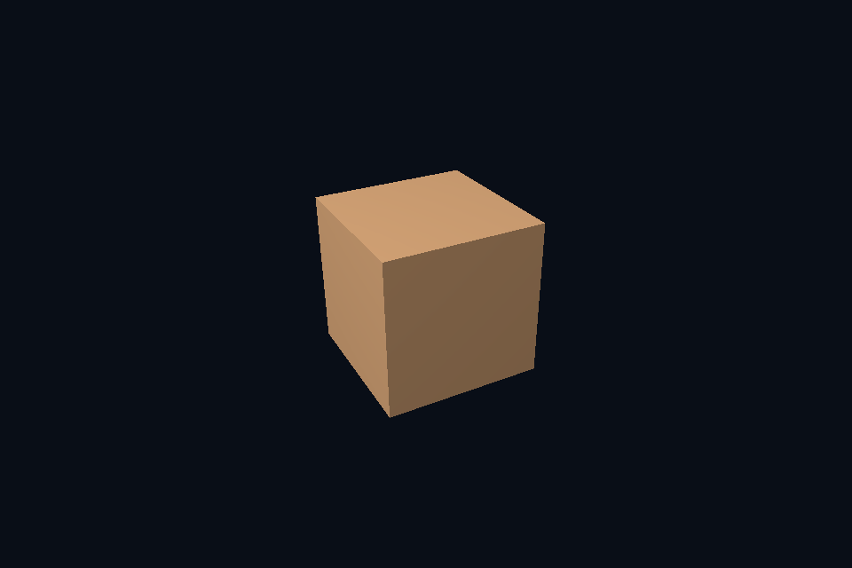

# vk41_subresource_view · 限定子资源视图

[54 课目录](../../COURSE.md)

## 目的与实际执行

普通交换链 view 指向一张图像的颜色面。扩展实验把可采样纹理的 view 限定到最后一级 mip，观察整体成为近似平均颜色；view 的 baseMipLevel 与 sampler LOD 是相关但不同的范围。

ImageView 覆盖完整级数、sampler mipmapMode=LINEAR 且 maxLod 合法。另一个实验只暴露最后一级 view，明确展示 view 范围改变而资源存储不变。

本程序有独立实验选择与验证路径，公共实现集中在 advanced_labs.cpp。设备/API 检查、数值 compute 与图形渲染采用不同证据；不是每个程序都会弹出窗口。

## 构建和运行

```powershell
cmake --preset vulkan-native
cmake --build --preset vulkan-native-debug --target vk41_subresource_view --parallel 4
.\Vulkan\native\build\bin\Debug\vk41_subresource_view.exe
```

## 深入学习：数据、接口与执行

- [第 11 课：图像与 View：限定子资源访问](../../chapters/11_image_views/README.md)
- [第 44 课：LOD、子资源视图与三线性过滤](../../chapters/44_mip_sampling/README.md)

### 本课的真实源码切片

来自 [Vulkan/native/common/advanced_labs.cpp](../../common/advanced_labs.cpp#L448)，第 448—491 行；这是现有实现的局部摘录，末尾可能处于函数中间，不是可单独编译的完整程序。

```cpp
    void attach(SceneVk& scene, bool lastMip = false) {
        if (lastMip) {
            VkImageViewCreateInfo ci{VK_STRUCTURE_TYPE_IMAGE_VIEW_CREATE_INFO};
            ci.image = image.image;
            ci.viewType = VK_IMAGE_VIEW_TYPE_2D;
            ci.format = format;
            ci.subresourceRange = {
                VK_IMAGE_ASPECT_COLOR_BIT, uint32_t(reference.size() - 1), 1, 0, 1};
            vkCheck(vkCreateImageView(c.device, &ci, nullptr, &selectedView));
        }
        VkDescriptorImageInfo info{
            sampler, lastMip ? selectedView : image.view, VK_IMAGE_LAYOUT_SHADER_READ_ONLY_OPTIMAL};
        VkWriteDescriptorSet write{VK_STRUCTURE_TYPE_WRITE_DESCRIPTOR_SET};
        write.dstSet = scene.descriptor;
        write.dstBinding = 1;
        write.descriptorCount = 1;
        write.descriptorType = VK_DESCRIPTOR_TYPE_COMBINED_IMAGE_SAMPLER;
        write.pImageInfo = &info;
        vkUpdateDescriptorSets(c.device, 1, &write, 0, nullptr);
    }
    // 逐级复制到可见缓冲并核对每个 texel，避免只检查第一个级别或最终画面。
    void verify() {
        VkDeviceSize bytes = 0;
        std::vector<VkDeviceSize> offsets;
        for (const auto& p : reference) {
            offsets.push_back(bytes);
            bytes += p.rgba.size();
        }
        VkBufferResource readback;
        readback.init(c, bytes, VK_BUFFER_USAGE_TRANSFER_DST_BIT);
        immediate(c, [&](VkCommandBuffer cmd) {
            for (uint32_t i = 0; i < reference.size(); ++i) {
                imageDependency(cmd,
                                image.image,
                                i,
                                VK_IMAGE_LAYOUT_SHADER_READ_ONLY_OPTIMAL,
                                VK_IMAGE_LAYOUT_TRANSFER_SRC_OPTIMAL,
                                VK_PIPELINE_STAGE_2_ALL_COMMANDS_BIT,
                                VK_ACCESS_2_MEMORY_READ_BIT | VK_ACCESS_2_MEMORY_WRITE_BIT,
                                VK_PIPELINE_STAGE_2_COPY_BIT,
                                VK_ACCESS_2_TRANSFER_READ_BIT);
                VkBufferImageCopy copy{};
                copy.bufferOffset = offsets[i];
                copy.imageSubresource = {VK_IMAGE_ASPECT_COLOR_BIT, i, 0, 1};
```

### 同主题跨 API 导航

| 路线 | 程序 |
| --- | --- |
| Vulkan 原生 | [vk41_subresource_view](README.md) |
| 对照后端 | [dx41_subresource_view](../../../../DirectX12/lessons/dx41_subresource_view/README.md) |

### 先预测，再验证

只把 view 的 mip 范围缩到最后一级，为什么资源的总分配大小没有随之缩小？

参考推导：view 不拥有存储。原始纹理仍有完整 mip 链，只是当前接口暴露其中一段。

固定相机观察远处小物体，比较单级、完整 mip 与末级 view，并记录哪些差异来自范围、哪些来自过滤。

参考推导：末级 view 强制只见低分辨率平均图；完整 mip 按采样尺度选择；单级可能高频闪烁。不能把三者都解释为“纹理没加载”。

## 验证与边界

运行 `--smoke` 执行有限自动检查。数值实验读取实际 GPU 结果，图形实验检查非空图像并可查看读回。交互重建与性能还需额外证据；窗口 renderer 当前保留串行等待，双槽计算实验不会被描述为完整多帧呈现引擎。

## 实际画面


