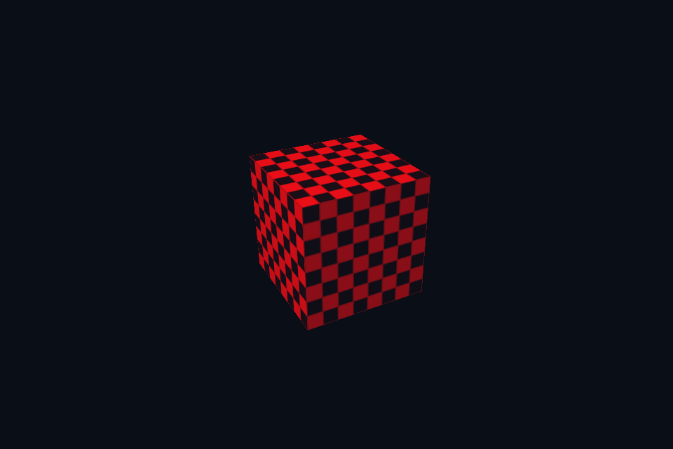

# vk43_color_write_mask · 固定功能颜色写掩码

[54 课目录](../../COURSE.md)

## 目的与实际执行

分别运行 half-scissor、half-viewport、back-face culling 和 red-only 写掩码实验。viewport/scissor 是管线声明的 dynamic state，cull 与写掩码在本实现中仍是创建时配置。投影 Y 翻转也会影响屏幕绕序判断。 本实验共用外表面逆时针模型：Vulkan 使用 COUNTER_CLOCKWISE，DX12 显式设置 FrontCounterClockwise=TRUE；不可依赖两边零初始化得到同一正面。

本程序有独立实验选择与验证路径，公共实现集中在 advanced_labs.cpp。设备/API 检查、数值 compute 与图形渲染采用不同证据；不是每个程序都会弹出窗口。

## 构建和运行

```powershell
cmake --preset vulkan-native
cmake --build --preset vulkan-native-debug --target vk43_color_write_mask --parallel 4
.\Vulkan\native\build\bin\Debug\vk43_color_write_mask.exe
```

## 深入学习：数据、接口与执行

- [第 14 课：固定功能、颜色掩码、视口与剔除](../../chapters/14_fixed_function/README.md)

### 本课的真实源码切片

来自 [Vulkan/common/scene_vk.hpp](../../../common/scene_vk.hpp#L366)，第 366—409 行；这是现有实现的局部摘录，末尾可能处于函数中间，不是可单独编译的完整程序。

```cpp
        VkPipelineMultisampleStateCreateInfo ms{
            VK_STRUCTURE_TYPE_PIPELINE_MULTISAMPLE_STATE_CREATE_INFO};
        ms.rasterizationSamples = samples;
        VkPipelineDepthStencilStateCreateInfo depth{
            VK_STRUCTURE_TYPE_PIPELINE_DEPTH_STENCIL_STATE_CREATE_INFO};
        depth.depthTestEnable = depth.depthWriteEnable = mode >= 5;
        depth.depthCompareOp = VK_COMPARE_OP_LESS;
        VkPipelineColorBlendAttachmentState attachment{};
        attachment.colorWriteMask =
            redOnly ? VK_COLOR_COMPONENT_R_BIT | VK_COLOR_COMPONENT_A_BIT : 15;
        VkPipelineColorBlendStateCreateInfo blend{
            VK_STRUCTURE_TYPE_PIPELINE_COLOR_BLEND_STATE_CREATE_INFO};
        blend.attachmentCount = 1;
        blend.pAttachments = &attachment;
        VkDynamicState ds[] = {VK_DYNAMIC_STATE_VIEWPORT, VK_DYNAMIC_STATE_SCISSOR};
        VkPipelineDynamicStateCreateInfo dynamic{
            VK_STRUCTURE_TYPE_PIPELINE_DYNAMIC_STATE_CREATE_INFO};
        dynamic.dynamicStateCount = 2;
        dynamic.pDynamicStates = ds;

        // 动态渲染不创建 render pass，但管线仍需声明颜色和深度附件格式。
        VkPipelineRenderingCreateInfo rendering{VK_STRUCTURE_TYPE_PIPELINE_RENDERING_CREATE_INFO};
        rendering.colorAttachmentCount = 1;
        rendering.pColorAttachmentFormats = &colorFormat;
        rendering.depthAttachmentFormat = VK_FORMAT_D32_SFLOAT;
        VkGraphicsPipelineCreateInfo gp{VK_STRUCTURE_TYPE_GRAPHICS_PIPELINE_CREATE_INFO};
        gp.pNext = &rendering;
        gp.stageCount = 2;
        gp.pStages = stages;
        gp.pVertexInputState = &vi;
        gp.pInputAssemblyState = &ia;
        gp.pViewportState = &viewport;
        gp.pRasterizationState = &raster;
        gp.pMultisampleState = &ms;
        gp.pDepthStencilState = &depth;
        gp.pColorBlendState = &blend;
        gp.pDynamicState = &dynamic;
        gp.layout = pipelineLayout;
        VkResult result = vkCreateGraphicsPipelines(c.device, cache, 1, &gp, nullptr, &pipeline);
        vkDestroyShaderModule(c.device, vs, nullptr);
        vkDestroyShaderModule(c.device, ps, nullptr);
        vkCheck(result, "Graphics pipeline");
    }

```

### 同主题跨 API 导航

| 路线 | 程序 |
| --- | --- |
| Vulkan 原生 | [vk43_color_write_mask](README.md) |
| 对照后端 | [dx43_color_write_mask](../../../../DirectX12/lessons/dx43_color_write_mask/README.md) |

### 先预测，再验证

先预测半视口与半裁剪的区别，再分别运行对应实验，检查模型宽高和可见区域。

参考推导：半视口把整幅几何压进较窄映射，半裁剪保留原映射但屏蔽右侧。它们可能显示相同面积，却不是相同几何变换。

## 验证与边界

运行 `--smoke` 执行有限自动检查。数值实验读取实际 GPU 结果，图形实验检查非空图像并可查看读回。交互重建与性能还需额外证据；窗口 renderer 当前保留串行等待，双槽计算实验不会被描述为完整多帧呈现引擎。

## 实际画面


