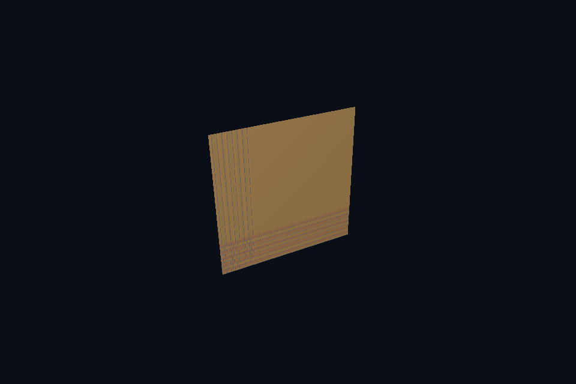

# vk52_sampler_addressing · 纹理寻址

[54 课目录](../../COURSE.md)

## 目的与实际执行

sampler 指定 addressMode、min/magFilter、mipmapMode 和 maxLod；组合 descriptor 同时引用 sampler/image view，但二者仍是独立对象。各向异性另有特性与限制，本例不假装已经启用。

本程序有独立实验选择与验证路径，公共实现集中在 advanced_labs.cpp。设备/API 检查、数值 compute 与图形渲染采用不同证据；不是每个程序都会弹出窗口。

## 构建和运行

```powershell
cmake --preset vulkan-native
cmake --build --preset vulkan-native-debug --target vk52_sampler_addressing --parallel 4
.\Vulkan\native\build\bin\Debug\vk52_sampler_addressing.exe
```

## 深入学习：数据、接口与执行

- [第 36 课：采样器、过滤、寻址与 UV](../../chapters/36_samplers/README.md)

### 本课的真实源码切片

来自 [Vulkan/native/common/advanced_labs.cpp](../../common/advanced_labs.cpp#L433)，第 433—476 行；这是现有实现的局部摘录，末尾可能处于函数中间，不是可单独编译的完整程序。

```cpp
                                VK_PIPELINE_STAGE_2_COPY_BIT | VK_PIPELINE_STAGE_2_BLIT_BIT,
                                VK_ACCESS_2_TRANSFER_READ_BIT | VK_ACCESS_2_TRANSFER_WRITE_BIT,
                                VK_PIPELINE_STAGE_2_FRAGMENT_SHADER_BIT,
                                VK_ACCESS_2_SHADER_SAMPLED_READ_BIT);
        });
        VkSamplerCreateInfo si{VK_STRUCTURE_TYPE_SAMPLER_CREATE_INFO};
        si.magFilter = si.minFilter = VK_FILTER_LINEAR;
        si.mipmapMode = VK_SAMPLER_MIPMAP_MODE_LINEAR;
        si.addressModeU = si.addressModeV = si.addressModeW =
            clamp ? VK_SAMPLER_ADDRESS_MODE_CLAMP_TO_EDGE : VK_SAMPLER_ADDRESS_MODE_REPEAT;
        si.maxLod = float(levels - 1);
        vkCheck(vkCreateSampler(c.device, &si, nullptr, &sampler));
        std::cout << "Uploaded image " << pixels.width << 'x' << pixels.height
                  << ", mipLevels=" << levels << ", sRGB=" << srgb << '\n';
    }
    void attach(SceneVk& scene, bool lastMip = false) {
        if (lastMip) {
            VkImageViewCreateInfo ci{VK_STRUCTURE_TYPE_IMAGE_VIEW_CREATE_INFO};
            ci.image = image.image;
            ci.viewType = VK_IMAGE_VIEW_TYPE_2D;
            ci.format = format;
            ci.subresourceRange = {
                VK_IMAGE_ASPECT_COLOR_BIT, uint32_t(reference.size() - 1), 1, 0, 1};
            vkCheck(vkCreateImageView(c.device, &ci, nullptr, &selectedView));
        }
        VkDescriptorImageInfo info{
            sampler, lastMip ? selectedView : image.view, VK_IMAGE_LAYOUT_SHADER_READ_ONLY_OPTIMAL};
        VkWriteDescriptorSet write{VK_STRUCTURE_TYPE_WRITE_DESCRIPTOR_SET};
        write.dstSet = scene.descriptor;
        write.dstBinding = 1;
        write.descriptorCount = 1;
        write.descriptorType = VK_DESCRIPTOR_TYPE_COMBINED_IMAGE_SAMPLER;
        write.pImageInfo = &info;
        vkUpdateDescriptorSets(c.device, 1, &write, 0, nullptr);
    }
    // 逐级复制到可见缓冲并核对每个 texel，避免只检查第一个级别或最终画面。
    void verify() {
        VkDeviceSize bytes = 0;
        std::vector<VkDeviceSize> offsets;
        for (const auto& p : reference) {
            offsets.push_back(bytes);
            bytes += p.rgba.size();
        }
        VkBufferResource readback;
```

### 同主题跨 API 导航

| 路线 | 程序 |
| --- | --- |
| Vulkan 原生 | [vk52_sampler_addressing](README.md) |
| 对照后端 | [dx52_sampler_addressing](../../../../DirectX12/lessons/dx52_sampler_addressing/README.md) |

### 先预测，再验证

在 UV=0..4 的测试几何上比较 clamp 与 repeat，解释边缘拉伸来自哪里。

参考推导：clamp 将越界坐标限制到边缘 texel，repeat 周期折回。两者都读取同一内容，区别来自寻址规则而非模型解析。

## 验证与边界

运行 `--smoke` 执行有限自动检查。数值实验读取实际 GPU 结果，图形实验检查非空图像并可查看读回。交互重建与性能还需额外证据；窗口 renderer 当前保留串行等待，双槽计算实验不会被描述为完整多帧呈现引擎。

## 实际画面


