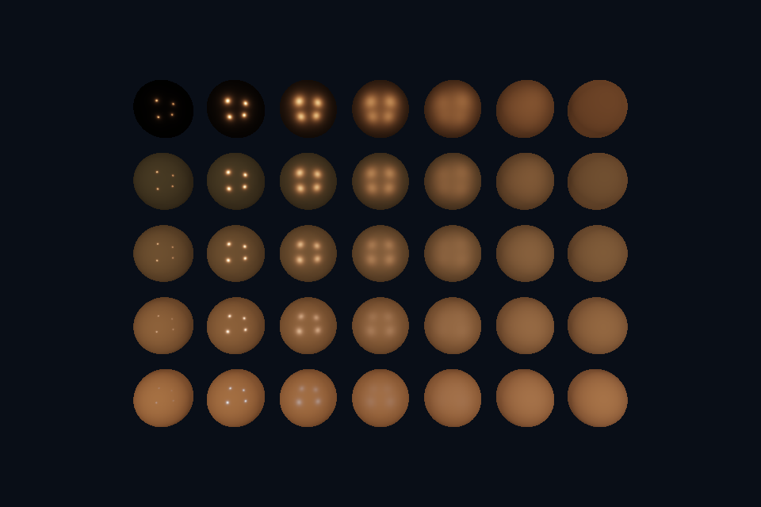

# nv06_pbr_viewport · PBR 视口与 UI 参数

[路线首页](../../README.md) · [原生 Vulkan 对照](../../../native/README.md)

## 构建与运行

```powershell
cmake --preset vulkan-nvpro
cmake --build --preset vulkan-nvpro-debug --target nv06_pbr_viewport --parallel 4
.\Vulkan\nvpro\build\bin\Debug\nv06_pbr_viewport.exe
```

以上命令从仓库根目录执行，也可使用本页“运行本课”。预期：35 个 PBR 球，Settings 可调 roughness scale。

## 代码阅读

先读 [main.cpp](main.cpp)，再读路线根目录 common/nvapp_course.hpp 的 NvLesson/nvproMain。框架实现位于 external/nvpro_core2；其固定 commit 和许可证见路线 README。共享底层实现位于 Vulkan/common/scene_vk.hpp，公共数学/几何位于 shared/scene.hpp。

SceneVk 继续计算直接光 PBR，nvapp 提供可停靠 Viewport 和交互参数。roughness scale 从 UI 进入 per-draw push constants，并限制到有效范围。场景 uniform 与 RenderTarget 在教学版中单份持有，因此 onRender 先等待前一帧队列；这明确牺牲 CPU/GPU 重叠来保证共享资源安全。后续优化应复制帧资源，而不是只移除等待。

## 动手练习

加入金属度和光强 UI；实现每帧独立 UBO，再比较同步与性能；将 OpenGL 的 IBL 移植到新 pass。

自测：列出本课中由 nvpro_core2 管理的对象，以及仍由 SceneVk/应用管理的对象。参考：Context/Application/RenderTarget/Allocator 负责各自对象，shader、pipeline layout、descriptor 与绘制逻辑仍有显式 Vulkan 状态；框架不会自动推断任意自定义 pass 的全部依赖。

## 检查

`nv06_pbr_viewport.exe --smoke` 使用 GPU 无窗口运行或控制台检查。渲染课读回 Viewport 图像为 PPM；计算课逐项验证。验证层错误会使测试失败。常规窗口的 resize/minimize、UI 输入和长时间运行需要另外检查，不能以 headless 通过代替全部交互验证。


## 实测画面

固定时间的 GPU 读回图像（nvpro 为 headless Viewport 输出）。


