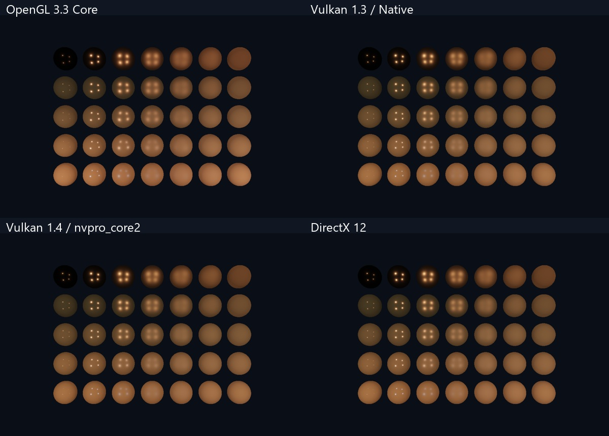

# 验证记录

日期：2026-11-04。最终本机工程目录：E:\GraphicsAPI-Tutorials。

| 路线 | Debug 检查 | 内容 |
| --- | --- | --- |
| OpenGL | 34/34 | GLSL 编译、真实上下文、四帧与图像读回检查 |
| Vulkan 原生 | 10/10 | 实例/队列、交换链、动态渲染、GPU 计算与读回、VUID 错误计数 |
| Vulkan / nvpro_core2 | 6/6 | Context、headless nvapp、VMA 上传、离屏读回、计算、PBR、验证回调 |
| DirectX 12 | 10/10 | 调试层/InfoQueue、资源/状态/提交、纹理、UAV 计算和图像读回 |

共 60/60 通过。数据在 [validation-results.json](validation-results.json)。原生 Vulkan、NV Context 和 DX12 三个 compute 例子分别逐项验证 256 个 i*i+1；图形课读回像素并检查动态范围。设备课和清屏课按其目标单独判断，未将无窗口的设备/计算示例伪装成可见场景。

## 实测环境

Windows x64，Visual Studio 2022 / MSVC 19.44，Windows SDK 10.0.26100，CMake 4.2.1，RTX 3060 / NVIDIA 610.88。OpenGL 3.3 Core，原生 Vulkan 请求 1.3；NV 请求 1.4。系统 SDK 工具 1.4.335，NV 使用项目固定的 1.4.341 headers/utility headers 和子模块 Volk。DX12 的 debug layer 已实际启用。

Vulkan 的 API 验证错误计数为零。当前系统有外部 overlay manifest 的 loader 诊断，课程会单独报告；未修改系统注册表或关闭其他软件。诊断与应用 VUID 错误区分处理，不因此宣称所有系统层都无诊断。

## 图像核查

已对三角形、纹理/深度、直接光 PBR 等 GPU 读回画面进行查看。各新课末尾提供截图。OpenGL 原有 11 组开关对比是先前扩充版的验证记录，本次合集复验为 34 个 smoke；没有把历史对比重复计入本次 60 个结果。

## 复验

从仓库根目录执行 `powershell -ExecutionPolicy Bypass -File .\scripts\build.ps1 -Track all -Test`。逐路线可用 `ctest --preset <路线>-debug`。原始本机日志在各 build/Testing/Temporary/LastTest.log，构建目录、日志、备份和本机缓存不上传 Git。

## 干净克隆检查

另外从本地 Git 仓库重新 `clone --recurse-submodules`，确认 nvpro_core2 子模块按固定提交检出；通过 `prepare-dependencies.ps1 -Track vulkan-native` 下载 GLFW/GLM 并校验 SHA256，然后配置、编译并运行 `vk03_triangle`，CTest 1/1 通过。此检查验证了源码缓存预下载路径；未将一次三角形检查描述为新克隆的全部 60 课复验。

## 范围

本次完成 Windows Debug 的真实 GPU 验证。Release 配置和打包流程已提供，但没有将其描述为全部运行验证；Linux、WARP、所有窗口交互组合、长期运行与多 GPU 未在本次逐项测试。CI 目前验证 Windows 编译，不执行硬件 GPU 测试，也不代替本机验证。Vulkan/DX12 的高级效果迁移范围和串行同步取舍见路线 README。
